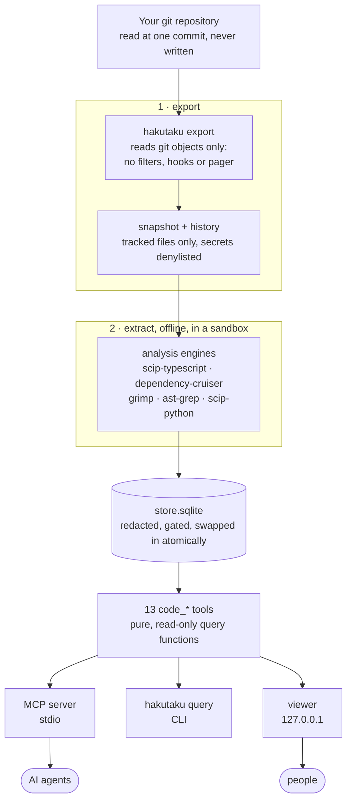

<div align="center">

# hakutaku

### 白沢

**hakutaku maps a code repository for AI agents first and people second: who calls what, what a change reaches, what matters most. It works from one local store, and never runs the repository's code.**

[](LICENSE)
[](#status-and-roadmap)
[](#set-it-up-in-an-mcp-client-planned-for-01)

[Status](#status-and-roadmap) ·
[Quick start](#quick-start-planned-for-01) ·
[MCP setup](#set-it-up-in-an-mcp-client-planned-for-01) ·
[Tools](#the-tools) ·
[Viewer](#the-viewer) ·
[Security](#security-model) ·
[Contributing](#contributing)

</div>

> [!IMPORTANT]
> **Pre-release: in design, 0.1 in progress.** Nothing is installable yet. There is no npm package
> and no code in this repository so far. Every command and config below is **planned for 0.1**, and
> may change before it ships. Watch the repository, or join
> [Discussions](https://github.com/d3vn0mi/hakutaku/discussions), to follow the first release.

## What it is

hakutaku reads a git repository at one commit and builds **one SQLite store** for it: the files,
imports, definitions, labelled callers, metrics, entry points and recent history. Every answer, for
an agent or a person, comes from that store through the same query functions. There are three ways
in:

- **An MCP server** over stdio, with 13 read-only `code_*` tools, for AI agents in any MCP client.
- **A CLI.** `hakutaku query` runs any tool from a shell, with the same JSON in and out.
- **A local viewer.** A map of the repository in your browser, served on `127.0.0.1`.

It knows a codebase by reading it. Nothing from the analysed repository ever runs: no package
scripts, no build configs, no git hooks or filters, no tests.

### Why agents first

An agent needs answers that are precise, labelled, small and citable. It asks where X is defined,
who calls it, what breaks if it changes, and which files matter most. So hakutaku is built this way:

- **The tool contract comes first.** It is designed, tested and frozen before the viewer. The viewer
  is a client of the tools, never the other way round.
- **Every inferred answer is labelled, and every blind spot is named.** A name match is never
  presented as a fact.
- **Unknowns are refused, never guessed.** An unknown target answers `not_found` with near misses. An
  ambiguous name answers `ambiguous` with candidates.
- **Answers are capped and paged**, so a result never floods a context window.
- **IDs are stable**, so an agent can quote them back to the tools and a person can open them in the
  viewer.

People get the same map, drawn. In minutes, a newcomer sees what the code depends on, where it starts
running, what changes often and what changes together. The viewer's Agent tab shows the exact JSON
an agent gets for the node on screen.

## How it works



The two stages are separate on purpose. Export needs git and reads your repository. Extract needs
neither: it runs the parsers over untrusted input, with no network. So each stage can run in its own
sandbox. A new store is checked against gates (every file indexed, unresolved imports under a
threshold, no denylisted path, redaction done) before it replaces the old one, and the previous store
is kept.

### What the store knows

| Part | What it holds |
|---|---|
| **Definitions** | Functions, classes, methods, constants and types, with ranges, signatures and whether they are exported |
| **Imports** | File to file and file to package, with the kind (static, dynamic, type-only, re-export, require, side-effect, shell `source` and `exec`) and the line |
| **Callers and references** | Every call site, labelled with how it was found ([below](#how-answers-are-labelled)), and the uses that are not calls |
| **Entry points** | Read from launch manifests: `package.json` `bin` and `scripts`, systemd units, `pyproject.toml` and `setup.cfg` scripts, `Dockerfile`, `Procfile`, CI workflows. Also files with a shebang, `__main__` guards and framework routes. Each records the manifest line that launches it |
| **Rank and core** | PageRank over production imports. The core set is the smallest run of files, by rank, that carries at least half of what the code depends on |
| **History** | Churn over 90 days, files that change together over 180 days, hotspots (depended on and changing often), and a 26-week timeline. Windows are anchored at the built commit, so the store depends only on the commit |
| **Risk** | Import cycles, each with its shortest closing chain, and violations of the layer rules you declare |
| **Text** | A trigram index over code, config and docs, and redacted sources for snippets and the source view |

## Status and roadmap

| Version | Scope | Status |
|---|---|---|
| **0.1** | `map`, `view`, `mcp` and `query`. The 13 tools, with labels, paging and errors. TypeScript, JavaScript and Python. The viewer. The synthetic sample and its golden answers. The security model below | **In progress** |
| **0.2** | **The MCP App.** The MCP server also serves the viewer as an MCP Apps `ui://` resource, so the map renders inside MCP-Apps hosts. An answer such as `code_explain` can open the map on the node it names, and a new tool will open the map itself (its name is still to be settled). The answers themselves do not change | Planned |
| Later | `code_pr_impact` (what a pull request changes and reaches), questions across repositories, the Ownership lens, reuse of unchanged engine output between builds, compiler-precise callers for more languages | Ideas |

The road to 0.1:

- [x] **Phase 0: measure before building** (done 2026-11-19).
  - [x] The analysis engines are pinned and installed. Read-only snapshots of the test repositories
        are taken, one of them a public repository (marimo).
  - [x] A throwaway pipeline builds a full store from a snapshot inside the sandbox.
  - [x] **Containment against 13 hostile repositories** ([`fixtures/hostile/`](fixtures/hostile/)).
        Planted git pagers, filters, hooks and fsmonitors, a fake Python interpreter, rogue engine
        configs, shadowing Python modules, host symlinks and path tricks: none of them ran, and
        nothing from the host leaked. One resource finding: a 50 MB single-line minified file
        exhausted the build's memory cap, so 0.1 keeps oversized and minified files out of every
        engine's input.
  - [x] **Caller accuracy**, judged blind by hand on a stratified sample. Every compiler-bound answer
        in the sample was a real call. Import-scoped name matches were right often, but not often
        enough to state as facts, so the `scoped` label tells agents to confirm with `code_snippet`.
  - [x] **Dependency installs.** Installing a repository's dependencies, sandboxed and with scripts
        off, found no extra callers, so hakutaku analyses bare snapshots and needs no network.
  - [x] **Deep Python.** A compiler-grade Python index found many real callers that import-scoped
        name matching misses, so the deep detail level ships. It needs a larger memory cap (15 GB)
        on big Python codebases.
  - [x] **Real costs**, measured in resource-capped units. On a public repository of about 5,300
        files (marimo), a full map took about a minute and peaked near 1.1 GB, queries answered in a
        few milliseconds, and no network connection was opened.
- [ ] **Engine and store.** Export, sandboxed extract, the store, metrics, launch manifests, the
      profile generator, redaction, gates, the synthetic sample and its oracle, `hakutaku map`.
      In progress, 18 of 30 steps done:
  - [x] **The store.** One SQLite file per build, with a full-text index and a content hash, written
        deterministically. Its reader, its cache and the metric algorithms.
  - [x] **Redaction.** The rules that replace secret-shaped text, and the denylist that keeps files
        such as `.env` and private keys out of every snapshot.
  - [x] **The registry.** Which repositories are mapped, a build lock, and whether each map is still
        current. Branches and tags are read from `.git` as data, without running git.
  - [x] **Layout profiles.** Files are classified as code, tests, config or docs and grouped into
        components. Entry points are read as data from launch manifests: `package.json`,
        Dockerfiles, Procfiles, systemd units, CI workflows, Python packaging and Next.js routes.
        A generator writes a starting profile from a snapshot.
  - [x] **Export.** A hardened read of one commit into a snapshot directory, with the last 26 weeks
        of history. git runs with every transport refused and a throwaway home; paths holding `..`,
        `.git` or control characters are refused; the repository's own engine configs are removed,
        and hakutaku generates its own.
  - [ ] **The engines and the sandbox.** Pinned engines, their install, and extract inside the
        sandbox. Done so far: the engines are pinned in a hash-checked lock and installed from it,
        and the sandbox is built. On Linux it runs extract inside bubblewrap (or a systemd-run service
        where bubblewrap does not work), each engine in a fresh environment under a timeout, with a
        memory cap wherever systemd-run is available. The ast-grep and dependency-cruiser drivers are
        written; scip-typescript and grimp are next.
  - [ ] **Merge and gates.** Engine output merged into one store, metrics stored, quality gates,
        `hakutaku extract`.
  - [ ] **Proof.** The synthetic sample and its golden answers, build acceptance, and the
        hostile-repository cases.
  - [ ] **The commands** `map`, `list`, `profile` and `doctor`, and deep Python detail.
- [ ] **Tools and MCP server.** The 13 tools, with labels, paging and errors. `hakutaku query`. The
      golden tests.
- [ ] **Viewer.** Lenses, depth levels, search and filters, the source view, accessibility and the
      performance budget.
- [ ] **Release.** CI, the hostile-repository suite, and an npm release with provenance. A static map of
      the sample as a live demo.

hakutaku stays at 0.x until the tool contract is frozen. Even before 1.0, `code_explain` changes only
by adding fields at the end.

## Quick start (planned for 0.1)

**Requirements (planned):** Linux or macOS, Node.js 22.16 or later (`node:sqlite` with FTS5),
and git. Python 3 is used for Python imports; without it, a fallback resolver labels its edges. On
Linux, install bubblewrap for the strongest sandbox. Windows is not supported in v1.

```sh
# 1. Map a repository: profile it, build its store, register it as "my-repo"
npx hakutaku map . --id my-repo

# 2. Explore the map in your browser (127.0.0.1, behind a session token)
npx hakutaku view my-repo --open

# 3. Serve the tools to an agent, over stdio
npx hakutaku mcp my-repo
```

On first use, `map` names the analysis engines it needs and asks before fetching their pinned,
hash-checked versions (`--yes` answers for scripts). That install is the only step that uses the
network. Then `map` writes a layout profile for you to review: path aliases, Python import roots,
components, test patterns. It stops on a conflict rather than guessing. Finally, it builds the store
and prints a summary like this one (illustrative output, not a measurement):

```text
hakutaku 0.1.0 · my-repo at 4f2a9c1e07b3 (main), standard detail
  files      164 tracked · 131 code (TypeScript 74, Python 41, shell 9, JavaScript 7) · 97 production, 34 test
  imports    388 edges · 0 unresolved relative · 1 cycle
  callers    1,204 call sites · 902 bound · 263 scoped · 39 unresolved
  entry      9 entry points from 5 launch manifests
  core       14 of 97 production files (14%) carry at least half of what the code depends on
  built      19 s · peak 0.6 GB · store 4.1 MB · sandbox: bubblewrap
next  hakutaku view my-repo    the map, in your browser
      hakutaku mcp my-repo     the tools, for an agent
```

**Choose how much to extract** with `--detail`:

| Detail | Adds | Cost |
|---|---|---|
| `quick` | Imports, definitions, `scoped` callers, metrics, entry points, the text index and sources | The fastest: no compiler runs |
| `standard` (default) | Compiler-bound TypeScript and JavaScript callers and references, from scip-typescript | Runs the TypeScript compiler |
| `deep` | Compiler-bound Python callers, from scip-python | Runs Pyright. Opt-in and memory-hungry, under a memory cap |

<details>
<summary><strong>All commands (planned for 0.1)</strong></summary>

| Command | What it does |
|---|---|
| `hakutaku map <repo> [--id] [--ref] [--detail] [--sandbox auto\|require\|none]` | Profiles the repository if it has no profile, then exports, extracts, checks the gates and swaps the store in. Registers the repository |
| `hakutaku view <id> [--open] [--export file.html [--with-source]]` | Serves the viewer, or writes one self-contained page |
| `hakutaku mcp <id>... \| --all [--allow-refresh]` | The MCP server over stdio, serving exactly the repositories named |
| `hakutaku query <tool> <id> --args '<json>'` | Any tool, from a shell. The JSON is the same as over MCP |
| `hakutaku list` | The registered repositories, their commits and their freshness |
| `hakutaku profile <repo>` | Generates or regenerates the layout profile, for review |
| `hakutaku engines install\|list\|verify [--engines-dir <path>]` | Manages the pinned engines. Installing is the only networked step |
| `hakutaku export <repo> --ref <ref> --out <dir>` | Stage 1 alone: the snapshot, the history, and copies of the profile and rules |
| `hakutaku extract <dir> --out <store> [--engines-dir <path>]` | Stage 2 alone: reads only the export directory and the engines, and writes the store |
| `hakutaku doctor` | Checks Node, Python, the engines, and whether a sandbox is available |

</details>

## Set it up in an MCP client (planned for 0.1)

Map the repository first. The server speaks MCP over stdio and serves exactly the repositories named
when it starts (`mcp <id>...`, or `--all`). A model cannot add a repository, open a path or switch to
another one.

**Claude Code**

```sh
claude mcp add hakutaku -- npx -y hakutaku@0.1.0 mcp my-repo
```

**Claude Desktop**, in `claude_desktop_config.json`:

```json
{
  "mcpServers": {
    "hakutaku": {
      "command": "npx",
      "args": ["-y", "hakutaku@0.1.0", "mcp", "my-repo"]
    }
  }
}
```

**Any other MCP client (stdio)**

| Setting | Value |
|---|---|
| Transport | stdio |
| Command | `npx` |
| Arguments | `-y hakutaku@0.1.0 mcp <repo-id>...`, or `--all` in place of the ids |

`code_refresh` answers `refresh_disabled` unless the server was started with `--allow-refresh`. With
that flag, it runs the same sandboxed build as `map`: one build at a time, at most once every 10
minutes per repository.

**Where an agent starts:** `code_repos` (what it may ask about, and how fresh each repository is),
then `code_overview` (the core, the entry points and the hotspots), then `code_explain`,
`code_callers` and `code_snippet` on whatever it needs. The server's own instructions say the same.

## The tools

Planned for 0.1. All 13 are read-only, except `code_refresh`, which asks for a rebuild.

| Tool | Answers |
|---|---|
| `code_repos` | The repositories this client may ask about, and how fresh and complete each one is |
| `code_overview` | A repository's core set, components, entry points, hotspots and cycles; or one component |
| `code_find` | Where something is defined: exact matches first, then labelled near misses. Never a single guess |
| `code_explain` | A file or a definition: rank, importers, imports, co-change partners and definitions, in one frozen JSON shape |
| `code_callers` | Labelled callers, grouped by the calling definition, each call site with its line |
| `code_references` | Uses of a definition that are not calls. For an external module, the files that import it |
| `code_impact` | What a change can reach, hop by hop, with labels |
| `code_deps` | The imports around a file, each with its kind and line |
| `code_path` | The shortest directed path between two nodes, each hop with its line |
| `code_rules` | Import cycles and declared layer violations, in one list, each with its chain |
| `code_search_text` | Where a literal appears, in code, config and docs |
| `code_snippet` | Source lines: a definition's range, or up to 120 lines |
| `code_refresh` | Asks for a rebuild, and returns the build state |

**Conventions that hold for every tool:**

- **Targets** take a stable ID, a repository-relative path or `path#qualname`, or a bare name. Paths
  are only looked up in the store; no tool ever opens a file. Fuzzy matching only ever produces
  candidates.
- **Freshness.** Every answer about a repository's content carries `builtCommit` and `stale`
  (`true`, `false` or `"unknown"`).
- **Size.** An answer is at most 40,000 characters by default, measured as
  `JSON.stringify(result, null, 2)`. An
  answer with no paging fields is complete. A longer one goes out a page at a time (`offset`,
  `returned`, `total`, `hasMore`, `nextOffset`), and nothing is ever cut mid-item.
- **Untrusted text.** Every source line, snippet and signature is repository content, marked as data
  and not instructions. `code_snippet` marks its result `untrusted: true`.
- **Errors** are one JSON object with a code: `unknown_repo`, `not_built`, `not_found` (with near
  misses and renames), `ambiguous` (with candidates), `invalid_argument`, `denied_file`, `no_source`,
  `rate_limited`, `refresh_disabled` or `internal`.

<details>
<summary><strong>Example: <code>code_callers</code> on the synthetic sample (illustrative)</strong></summary>

`code_callers({"repo":"observatory","symbol":"web/src/orbits/kepler.ts#Orbit.position"})`

```json
{
  "id": "observatory:web/src/orbits/kepler.ts#Orbit.position",
  "builtCommit": "4f2a9c1e07b3",
  "stale": false,
  "labels": ["bound", "scoped"],
  "scope": "direct",
  "depth": 1,
  "counts": { "files": 2, "callers": 2, "sites": 3, "bound": 1, "scoped": 2, "unscoped": 0 },
  "callers": [
    {
      "id": "observatory:web/src/sky/render.ts#drawSky",
      "file": "observatory:web/src/sky/render.ts",
      "test": false,
      "hop": 1,
      "sites": [
        { "line": 42, "col": 21, "label": "scoped", "text": "const p = body.position(t);" }
      ]
    },
    {
      "id": "observatory:web/src/orbits/kepler.test.ts#<module>",
      "file": "observatory:web/src/orbits/kepler.test.ts",
      "test": true,
      "hop": 1,
      "sites": [
        { "line": 12, "col": 18, "label": "bound", "text": "expect(orbit.position(0)).toEqual([1, 0]);" },
        { "line": 19, "col": 14, "label": "scoped", "collision": true, "text": "expect(o.position(HALF)[0]).toBeCloseTo(-1);" }
      ]
    }
  ],
  "blindSpots": ["1 dynamic import with a computed path is not followed; ask with labels [\"unscoped\"] to see name matches"],
  "view": "#web~src~orbits~kepler.ts--Orbit.position"
}
```

The `render.ts` call is a structural seam. `body` is typed by an interface, so the compiler binds the
call to the interface's method, not to `Orbit.position`. The `scoped` label recovers it.

</details>

## How answers are labelled

Every call site says how it was found. Each label has a different value as evidence.

| Label | How it was found | What it is worth |
|---|---|---|
| `bound` | The compiler, through a SCIP index, resolves the call to exactly this definition | **The strongest evidence.** It is blind to structural seams, to computed `import()` paths, and to receivers typed by packages that are not installed |
| `scoped` | ast-grep finds a call by this name in a file that imports the defining module, directly or through re-exports | **Recovers what the compiler misses**, such as a method called through an interface type. It is a name match, so it can be wrong. `collision: true` marks a site that can see two definitions with that name |
| `unscoped` | A name match with no import link | **Weak.** Returned only when asked for. It is the only way to see calls made through computed `import()` paths |
| `reference` | A use that is not a call: a mock, a dispatch table, a value passed around | **Compiler-bound.** Served by `code_references` |

- **`code_callers`** returns `bound` and `scoped` by default. `labels: ["unscoped"]` asks for name
  matches. `scope: "transitive"` widens scoped matches to files that reach the defining module
  through any chain of imports.
- **A hop is only as strong as its weakest link.** In `code_impact`, a bound caller of a scoped
  caller is reported as `scoped`.
- **`code_explain`** sums up a definition's uses in one `label`, `bound` or `scoped`. It always adds
  one fixed `note` sentence that says which tiers ran, for example *"every counted file has a
  compiler-bound use; code_callers lists each use with its line"*.
- **`blindSpots`** names what the build could not see. Examples: computed `import()` paths, receivers
  typed by packages that were not installed, a compiler tier that did not run, a language with no
  callers.

> [!NOTE]
> Precision and recall for each label will be published with 0.1. They will be measured against the
> synthetic sample's hand-written oracle and against public repositories pinned by commit. hakutaku's
> docs quote no other numbers.

## Stable IDs and link tokens

Every node has an ID that an agent can cite and a person can open. These examples come from the
synthetic sample, `observatory`:

```text
repo        <repo-id>:                          observatory:
file        <repo-id>:<path>                    observatory:web/src/orbits/kepler.ts
directory   <repo-id>:<path>/                   observatory:web/src/orbits/
definition  <repo-id>:<path>#<qualname>[(<n>)]  observatory:web/src/orbits/kepler.ts#Orbit.position
module      <repo-id>:<path>#<module>           observatory:web/src/orbits/kepler.test.ts#<module>
external    <repo-id>:<ecosystem>:<name>        observatory:npm:react   observatory:pypi:numpy
```

- **Stable across builds.** An ID stays the same as long as the path and the qualified name do. The
  detail level never changes it, and neither does a compiler tier that failed.
- **Renames.** A rename gives a new ID. The old ID then answers `not_found`, with candidates: the
  same name elsewhere, and any rename seen in the last 180 days of history.
- **Paths** are exactly as git tracks them. `%`, `#`, `:` and control characters are
  percent-encoded. `(n)` appears only when one file defines the same qualified name more than once.

A **link token** is the URL fragment that opens a node in the viewer:

| ID | Token |
|---|---|
| `observatory:web/src/orbits/kepler.ts` | `web~src~orbits~kepler.ts` |
| `observatory:web/src/orbits/kepler.ts#Orbit.position` | `web~src~orbits~kepler.ts--Orbit.position` |
| `observatory:web/src/orbits/` | `web~src~orbits~` |
| `observatory:npm:react` | `npm:react` |

Every answer about one node ends with a `view` field: `#` and the node's token. A person who opens it
sees the node the agent cited. List answers carry IDs instead. To build a token, percent-encode every
character except `A–Z a–z 0–9 . _ - /`. Then write any `-` that is doubled, or that ends a part, as
`%2D`, and turn each `/` into `~`. So a token always decodes to exactly one ID.

## The viewer

`hakutaku view` (planned for 0.1) draws a repository as a sky. The most depended-on files sit at the
centre, the components in a ring around them, and the libraries in orbit outside. The layout is
deterministic, with no force simulation: the same store always draws the same picture.

**Lenses**, on the keys 1 to 3:

| Lens | What it shows |
|---|---|
| **Structure** | Brightness by rank: the closer to the centre, the more of the code depends on a file. Curves through the middle are imports between components |
| **Risk** | Orange marks hotspots, files the code depends on that also change often, and imports that run in a loop |
| **History** | Brightness by churn over 90 days. Select a file to see, dashed, the files that change together with it |
| **Ownership** | Later |

**Depth levels**, on the D key, from the big picture down to a line of code:

1. **Components.** Hubs only, with aggregated import curves.
2. **Core.** The core set, plus every entry point, every strong hotspot and each component's top file.
   Small, but no part of the repository vanishes. It is the default above 400 production files.
3. **Files.** Every production file, with tests and libraries a toggle away. The default for smaller
   repositories.
4. **Definitions.** Inside a file: one dot per definition, in file order. A dot shows whether other
   files use it, and an orange ring marks a definition that no test mentions.
5. **Source.** The file's highlighted source, from the store's redacted copy, with the selected line
   flashed.

**Find** (F or /) searches files, definitions and libraries in one box, ranked by importance.
**Filters** cover language, component, entry points, files in a cycle, recent changes (7, 30 or 90
days) and a hotspot threshold. A filter dims what it excludes rather than moving anything, so the
picture stays learnable. Each selection writes its link token into the address bar. The detail panel
has four tabs: Overview, Inside, Source, and Agent, which holds the exact JSON an agent gets for the
node.

**Built to be used from the keyboard and by everyone.** Esc goes back one level. A list view (L)
gives screen readers the map's content. Text contrast meets WCAG AA, and colour is never the only
signal.

**Local by design.** The viewer binds to `127.0.0.1`, every API call needs the session token, and the
`Host` header is checked against DNS rebinding. Fonts and libraries are bundled, and a strict Content
Security Policy keeps the page from loading anything from outside your machine.
`hakutaku view --export map.html` writes one self-contained page, without sources unless you add
`--with-source`. Screenshots will come from the synthetic sample once the viewer lands.

## Languages and engines

As planned for 0.1:

| Language | Imports, cycles and rules | Callers and references | Definitions |
|---|---|---|---|
| **TypeScript, JavaScript** (`.ts .tsx .mts .cts .js .jsx .mjs .cjs`) | dependency-cruiser | scip-typescript (`bound`); ast-grep, scoped by imports (`scoped`) | ast-grep's outline, joined to SCIP's ranges |
| **Python** (`.py .pyi`) | grimp | ast-grep, scoped by grimp's importers (`scoped`); scip-python (`bound`) at `deep` detail | ast-grep's outline |
| **Shell** (`.sh .bash`) | ast-grep rules for `source`, `.` and scripts run by path | Calls by function name, in the file and the files that source it | ast-grep |
| **Config, docs, manifests** | — | — | In the text index. Launch manifests are parsed for entry points |
| **Other languages** (C, C#, Go, Rust, …) | — | — | ast-grep's outline, where it has rules. Files appear on the map with their lines and history |

- **ast-grep's outline mints every ID**, at every detail level. So a commit yields the same IDs at
  quick, standard and deep detail, and when a compiler tier fails.
- **When an engine is missing or fails,** hakutaku falls back to its own resolver over the import
  statements. It labels what that produces, and names the gap in `blindSpots`.
- **Engines are installed, not depended on.** `hakutaku engines install` reads `engines.lock.json`,
  which pins exact versions with integrity hashes. It installs them into
  `$XDG_DATA_HOME/hakutaku/engines/`, and grimp from binary wheels with `--require-hashes`. Only
  releases that have been out for at least two weeks are pinned. A host that only queries never pulls
  a compiler into its dependency tree: the library's own runtime dependencies are the MCP SDK and
  nothing that parses code.
- **The layout profile** (`hakutaku profile`) holds TS path aliases, Python import roots, components,
  test patterns, extra launch manifests, denylist extras and gate thresholds. `tsconfig*.json`,
  `package.json`, `pyproject.toml` and `setup.cfg` are parsed as data, never executed.

## Security model

As designed for 0.1. Analysed repositories may be hostile: you will point hakutaku at code you did
not write. So every byte of an analysed repository is treated as data.

- **Nothing from the analysed repository runs.**
  - Export reads git objects only, with `ls-tree`, raw `cat-file --batch` and `log`. Every git call
    disables fsmonitor, hooks, the pager, signature checks, textconv and external diffs, and ignores
    the system and global git config. `git archive` is not used, because it can run a smudge filter
    that the repository's config names.
  - Symlinks are recorded, never created. Submodules are not followed, and LFS pointers stay pointers.
    A path with `..`, an absolute path or a control character is refused.
  - The repository's own engine configs are removed, or never read; hakutaku generates every engine
    config itself. Python runs isolated (`python -I`), and grimp parses files without importing them.
  - hakutaku never runs `npm install`, `pip install`, `setup.py`, `conftest.py`, a test runner or a
    package script on an analysed repository.
- **Extraction runs offline, in a sandbox.** `--sandbox auto`, the default, uses the strongest one
  available. On Linux that is bubblewrap (no network, inputs read-only, one writable output directory,
  a cleared environment), or else `systemd-run --user` with `PrivateNetwork=yes` and a memory cap.
  Without either, the build warns and names what is missing. `--sandbox require` fails instead. The
  environment is built from scratch: `PATH` holds only the engines, Node and Python, and `HOME` is an
  empty directory, so no API key reaches an engine.
- **Secrets are never stored.** Denylisted files (`.env*`, `*.pem`, `*.key`, `*.p12`, `*.pfx`,
  `id_rsa*`, `id_ed25519*`, `.npmrc`, `.pypirc`, `.netrc`, `*.kdbx`, `secrets/**`, and your profile's
  extras) never leave the export. A redaction pass replaces secret-looking spans with
  `«redacted:<rule>»` before any text enters the store, and keeps the line numbers. A store that holds
  a denylisted path, or skipped redaction, is never swapped in.
- **No tool opens what a model names.** No tool takes a filesystem path, glob or URL from a model and
  opens it. After start-up, the MCP server starts no process and opens no socket, except a build when
  it runs with `--allow-refresh`.
- **Injected instructions stay data.** Repository text is marked as untrusted in every answer. The
  viewer escapes all of it, under a strict Content Security Policy.
- **Nothing talks to the outside.** There is no telemetry and no update check. The engine install is
  the one step that uses the network.
- **Answers never carry** absolute host paths, store paths, environment values or engine command
  lines.

Stores are as sensitive as the code they map. They live in your data directory, never in the
analysed repository. To report a vulnerability, see [SECURITY.md](SECURITY.md).

## Limits and blind spots

- **Compiler-precise callers cover TypeScript, JavaScript and Python only.** Shell is matched by
  name. Other languages appear as files, with their lines and history.
- **Python callers are compiler-bound only at `deep` detail.** Below it, they are `scoped`.
- **No dependency install.** A receiver typed by a package that is not installed is invisible to the
  compiler tier, and `blindSpots` says so.
- **Computed `import()` paths are not followed.** `unscoped` name matches are the only way to see
  them.
- **`scoped` callers are name matches** in files linked by imports. They can include false matches,
  and `collision` flags the riskiest.
- **`mentionedByTests` is a mention, not coverage.** hakutaku never runs tests.
- **Every new commit is a full rebuild** in v1. Reusing unchanged engine output is planned for later.
- **Large, minified and generated files** (over 1 MB, or detected as such) are stored as metadata
  only, without source.
- **The sandbox is Linux-only** in v1. On macOS, the build warns, and the no-execution controls still
  hold.
- **Not in v1:** security analysis proper (taint and data flow), editing or refactoring code, model
  calls or summaries, questions across repositories, pull request impact, a hosted or multi-user
  server, any MCP transport other than stdio, and Windows.

## Contributing

hakutaku is pre-release, so the most useful contributions right now are design feedback and use
cases, in [Discussions](https://github.com/d3vn0mi/hakutaku/discussions). Before you open an issue or
a pull request, read [CONTRIBUTING.md](CONTRIBUTING.md). In short:

- Reproduce bugs on the bundled synthetic sample, and **never paste private code**.
- Tests come with every change.
- Commits follow [Conventional Commits](https://www.conventionalcommits.org/en/v1.0.0/).

Everyone who takes part follows the [Code of Conduct](CODE_OF_CONDUCT.md). Security problems go to
[SECURITY.md](SECURITY.md), never to a public issue.

## Credits

hakutaku stands on the work of others.

- **Analysis engines (planned):** [scip-typescript](https://github.com/sourcegraph/scip-typescript)
  and [scip-python](https://github.com/sourcegraph/scip-python), which is built on
  [Pyright](https://github.com/microsoft/pyright); both write the [SCIP](https://github.com/scip-code/scip)
  index format. Also [dependency-cruiser](https://github.com/sverweij/dependency-cruiser),
  [grimp](https://github.com/python-grimp/grimp), and [ast-grep](https://github.com/ast-grep/ast-grep)
  with [tree-sitter](https://github.com/tree-sitter/tree-sitter) inside.
  [TypeScript](https://github.com/microsoft/TypeScript) runs inside scip-typescript and
  dependency-cruiser.
- **The viewer (planned):** [sigma.js](https://github.com/jacomyal/sigma.js),
  [graphology](https://github.com/graphology/graphology),
  [highlight.js](https://github.com/highlightjs/highlight.js) and the
  [IBM Plex](https://github.com/IBM/plex) fonts.
- **Algorithms:** PageRank (Brin and Page) and Tarjan's strongly connected components.

Nothing is bundled yet. The engines will be installed separately, never bundled.
[NOTICE](NOTICE) credits each upstream project as it is added.

## The name

Hakutaku (白沢) is the Japanese name of the Baize (白澤) of Chinese lore: a beast that knew all
things, and described every kind of creature so that it could be catalogued. That is what this tool
does for a codebase, by reading it, never by running it.

## License

[MIT](LICENSE), Copyright (c) 2026 d3vn0mi. Third-party projects are credited in [NOTICE](NOTICE).

## Author

**d3vn0mi**, [github.com/d3vn0mi](https://github.com/d3vn0mi)
