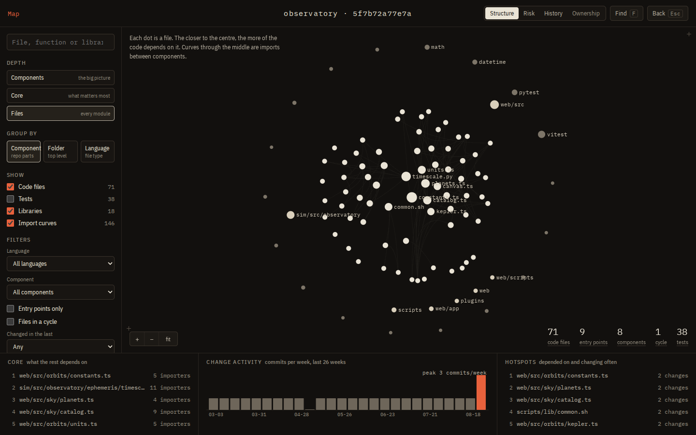
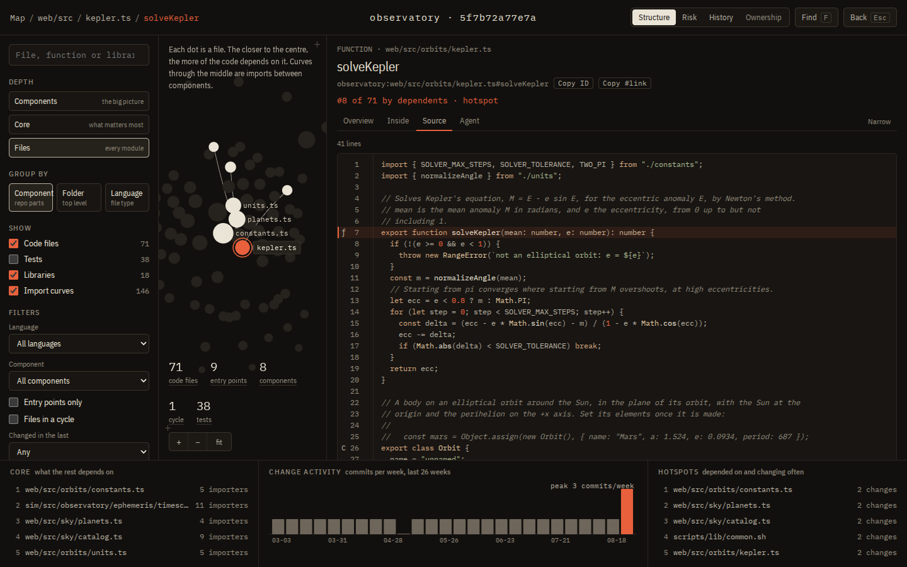

# hakutaku

hakutaku maps a code repository for AI agents first and people second: who calls what, what a change reaches, what matters most. It works from one local store, and never runs the repository's code.

## Quick start

You need Node.js 22.16 or later, on Linux or macOS, and git. Python 3 is optional: hakutaku reads
Python imports with it, and without it they come from hakutaku's own resolver, which the answers'
`blindSpots` name. On Linux, install bubblewrap too: it is the strongest sandbox for a build.
`hakutaku doctor` checks what your machine has.

```sh
# Install once, globally, outside any repository
npm install -g hakutaku@0.1.0

# Map a repository: profile it, build its store, and register it as "observatory"
hakutaku map ~/code/observatory

# Explore the map in your browser, on 127.0.0.1 behind a session token
hakutaku view observatory --open

# Serve the tools to an agent, over stdio
hakutaku mcp observatory
```

**Do not run hakutaku through `npx` inside a repository.** There, npx prefers a copy in the
repository's own `node_modules`, and reads its `.npmrc`, before hakutaku starts, so a hostile
repository could stand in for hakutaku and run its own code under hakutaku's name. A global install
keeps hakutaku outside every repository it maps.

`~/code/observatory` is the synthetic sample that every example here uses. To write it, run
`node fixtures/observatory/make.mjs ~/code` from a clone of this repository. Any git repository maps
the same way.

On first use, `map` names the analysis engines it needs, and asks before fetching their pinned,
hash-checked versions:

> hakutaku needs scip-typescript, dependency-cruiser and ast-grep (npm) and grimp (PyPI). Install the pinned versions now? [y/N]

`--yes` answers for scripts. That install is the only step that uses the network. Then `map` writes a
layout profile for you to review: path aliases, Python import roots, components, test patterns and
extra launch manifests. It stops on a conflict rather than guess. Finally, it builds the store and
prints a summary. The sample's, on Linux with bubblewrap:

```text
hakutaku 0.1.0 · observatory at 5f7b72a77e7a (HEAD), standard detail
  files      143 tracked · 109 code (TypeScript 65, Python 37, shell 4, JavaScript 3) · 71 production, 38 test
  imports    146 edges · 0 unresolved relative · 1 cycle
  callers    1,126 call sites · 191 bound · 160 scoped · 775 unresolved
  entry      13 entry points from 11 launch manifests
  core       24 of 71 production files (34%) carry at least half of what the code depends on
  built      2 s · peak 0.3 GB · store 0.9 MB · sandbox: bubblewrap
next  hakutaku view observatory    the map, in your browser
      hakutaku mcp observatory     the tools, for an agent
```

**Choose how much to extract** with `--detail`:

| Detail | Adds | Cost |
|---|---|---|
| `quick` | Imports, definitions, `scoped` callers, metrics, entry points, the text index and sources | Seconds; no compiler runs |
| `standard`, the default | Compiler-bound TypeScript and JavaScript callers and references, from scip-typescript | On marimo-team/marimo at `b0e402345e0a`: 64.8 s, a peak of 1,099 MB and a store of 194 MB |
| `deep` | Compiler-bound Python callers, from scip-python | Opt-in, with a memory cap |

[All commands](docs/design.md#all-commands) lists every command and option.

## Set up in an MCP client

Map the repository first. Then register `hakutaku mcp` with your MCP client, which starts it and
speaks MCP to it over stdio. In a client that reads a JSON configuration:

```json
{
  "mcpServers": {
    "hakutaku": {
      "command": "hakutaku",
      "args": ["mcp", "observatory"]
    }
  }
}
```

Register the globally installed `hakutaku`, never `npx`: a client starts its servers in a working
directory you do not choose, often the project itself, where npx would take a copy from that
project's `node_modules` first. A desktop client does not share your shell's `PATH`, so if it cannot
find `hakutaku`, or finds an older Node.js, register it by absolute paths, as
[Setting it up](docs/tools.md#setting-it-up) shows.

- **`mcp <id>...`** serves exactly the repositories named, and **`mcp --all`** every registered one.
  The list is fixed when the server starts: a model cannot add a repository, open a path or switch to
  another one.
- **`--allow-refresh`** lets `code_refresh` start a build: the same sandboxed build as `map`, one at
  a time, at most once every 10 minutes for each repository. Without it, `code_refresh` answers
  `refresh_disabled`.

**Where an agent starts:** `code_repos` (what it may ask about, and how fresh each repository is),
then `code_overview` (the core, the entry points and the hotspots), then `code_explain`,
`code_callers` and `code_snippet` on whatever it needs. The server's own instructions give a model
the same order.

## Tools

All 13 are read-only, except `code_refresh`, which asks for a rebuild. From a shell,
`hakutaku query <tool> <id> --args '<json>'` runs any of them, with the same JSON in and out as over
MCP.

| Tool | Answers |
|---|---|
| `code_repos` | The repositories this client may ask about, and how fresh and complete each one is |
| `code_overview` | A repository's core set, components, entry points, hotspots and cycles; or one component |
| `code_find` | Where something is defined: exact matches first, then labelled near misses. Never a single guess |
| `code_explain` | A file or a definition, in one frozen JSON shape. Anything else answers `invalid_argument`, with a hint that names the tool to ask instead |
| `code_callers` | Labelled callers, grouped by the calling definition, each call site with its line |
| `code_references` | Uses of a definition that are not calls. For an external module, the files that import it |
| `code_impact` | What a change can reach, hop by hop, with labels |
| `code_deps` | The imports around a file, each with its kind and line |
| `code_path` | The shortest directed path between two nodes, each hop with its line |
| `code_rules` | Import cycles and declared layer violations, in one list, each with its chain |
| `code_search_text` | Where a literal appears, in code, config and docs |
| `code_snippet` | Source lines: a definition's range, or up to 120 lines |
| `code_refresh` | Asks for a rebuild, and returns the build state |

**Conventions that hold for every tool:**

- **`repo`** is a repository id, matched exactly against the ones the server serves. It is never a
  path.
- **Targets** take one of three forms: a stable ID, a repository-relative path or `path#qualname`,
  or a bare name. Paths are only looked up in the store, and no tool ever opens a file. A bare name
  with several matches answers `ambiguous` with candidates, and with none, `not_found` with near
  misses: fuzzy matching only ever produces candidates.
- **Freshness.** Every answer about a repository's content carries `builtCommit` and `stale`
  (`true`, `false` or `"unknown"`).
- **Paging.** An answer is at most 40,000 characters by default, measured as
  `JSON.stringify(result, null, 2)`. An answer with no paging fields is complete. A longer one goes
  out a page at a time (`offset`, `returned`, `total`, `hasMore`, `nextOffset`), and nothing is ever
  cut mid-item.
- **Untrusted text.** Everything taken from the repository is data, not instructions: source lines,
  snippets and signatures, and also file paths, names and IDs, which a repository can fill with
  instruction-shaped text. `code_snippet` marks its result `untrusted: true`, and the MCP server
  marks every answer, and every error that can quote the repository, with
  `_meta: { "untrustedContent": true }`.

[The tools reference](docs/tools.md) gives every argument, answer, error and limit, with worked
examples on the sample.

## Labels

Every call site says how it was found, and each label is worth something different as evidence.
Tool descriptions and the MCP server's instructions give a model the sentence quoted for each:

| Label | How it is found | What a model is told |
|---|---|---|
| `bound` | The compiler resolves the call to exactly this definition, through a SCIP index: scip-typescript's, and scip-python's at `deep` detail | A compiler-bound call: the type checker resolved this call site to exactly this definition. |
| `scoped` | ast-grep finds a call by this name in a file that imports the defining module, directly or through re-exports | A candidate: a name match in a file that imports the defining module, not compiler-checked; confirm it with code_snippet before relying on it. |
| `unscoped` | A name match with no import link. Returned only when asked for | A bare name match with no import link; often a different definition with the same name, so treat it as a lead only. |
| `reference` | A use that is not a call, such as a mock, a dispatch table or a value passed around, from SCIP. Served by `code_references` | A use that is not a call, such as a value passed around, a mock or a dispatch-table entry, resolved by the compiler. |

**What each is worth**, in order of precision: `bound`, then `scoped`, then `reference` taken as a
caller, then `unscoped`, which comes back only when asked for.

- **`bound`** is the strongest evidence. It is blind to structural seams, to computed `import()`
  paths, and to receivers typed by packages that are not installed.
- **`scoped`** recovers what the compiler misses, such as a method called through an interface type,
  as in the example below. It is a name match, so it can be wrong: `collision: true` marks a site
  that can see two definitions with that name.
- **`reference`** is compiler-bound, but a use is not a call: taken as a caller, it says the code
  that holds the value may call it.
- **`unscoped`** is weak, and often names another definition with the same name. It is the only way
  to see calls made through computed `import()` paths.

`code_callers` returns `bound` and `scoped` by default. `labels: ["unscoped"]` asks for name matches,
and `scope: "transitive"` widens scoped matches to files that reach the defining module through any
chain of imports. In `code_impact`, a hop is only as strong as its weakest link: a bound caller of a
scoped caller is reported as `scoped`. `code_explain` sums up a definition's uses in one `label`,
`bound` or `scoped`, beside a fixed `note` that says which tiers ran.

**How the labels are checked.** CI checks every label on the synthetic sample's hand-written oracle,
[`fixtures/observatory/oracle.json`](fixtures/observatory/oracle.json): each call it lists, with its
label, and each reference, against the store and through the tools.

<details>
<summary><strong>Example: <code>code_callers</code> on the sample, from its golden answers</strong></summary>

`code_callers({"repo":"observatory","symbol":"web/src/orbits/kepler.ts#Orbit.position"})`

<!-- golden: code_callers/method -->
```json
{
  "id": "observatory:web/src/orbits/kepler.ts#Orbit.position",
  "builtCommit": "5f7b72a77e7a",
  "stale": false,
  "labels": [
    "bound",
    "scoped"
  ],
  "scope": "direct",
  "depth": 1,
  "counts": {
    "files": 2,
    "callers": 2,
    "sites": 3,
    "bound": 1,
    "scoped": 2,
    "unscoped": 0
  },
  "callers": [
    {
      "id": "observatory:web/src/sky/render.ts#drawSky",
      "file": "observatory:web/src/sky/render.ts",
      "test": false,
      "hop": 1,
      "sites": [
        {
          "line": 23,
          "col": 20,
          "label": "scoped",
          "text": "const p = body.position(t);"
        }
      ]
    },
    {
      "id": "observatory:web/src/orbits/kepler.test.ts#<module>",
      "file": "observatory:web/src/orbits/kepler.test.ts",
      "test": true,
      "hop": 1,
      "sites": [
        {
          "line": 26,
          "col": 18,
          "label": "bound",
          "text": "expect(orbit.position(0)).toEqual([1, 0]);"
        },
        {
          "line": 32,
          "col": 16,
          "label": "scoped",
          "collision": true,
          "text": "expect(o.position(HALF)[0]).toBeCloseTo(-1);"
        }
      ]
    }
  ],
  "blindSpots": [
    "1 dynamic import with a computed path is not followed; ask with labels [\"unscoped\"] to see name matches",
    "compiler-bound uses that match no outline definition are counted in coverage only (36)"
  ],
  "view": "#web~src~orbits~kepler.ts--Orbit.position"
}
```

The `render.ts` call is a structural seam. `body` is typed by an interface, so the compiler binds the
call to the interface's method, not to `Orbit.position`. The `scoped` label recovers it. The second
blind spot is a count across the whole map, not for this method alone: uses at call sites that the
compiler bound to a symbol of the repository matching no single definition in hakutaku's outline.


</details>

## Stable IDs and link tokens

Every node has an ID that an agent can cite and a person can open. The examples are nodes of the
sample, `observatory`:

```text
repo-id     [a-z0-9][a-z0-9._-]{0,63}
repo        <repo-id>:                            observatory:
file        <repo-id>:<path>                      observatory:web/src/orbits/kepler.ts
directory   <repo-id>:<path>/                     observatory:web/src/orbits/
definition  <repo-id>:<path>#<qualname>[(<n>)]    observatory:web/src/orbits/kepler.ts#Orbit.position
module      <repo-id>:<path>#<module>             observatory:web/src/orbits/kepler.test.ts#<module>
external    <repo-id>:<ecosystem>:<name>          observatory:npm:react   observatory:pypi:pytest
```

- **The path** is exactly as git tracks it, with `/` separators and case kept. `%`, `#`, `:` and
  control characters are percent-encoded, so the first `:` ends the repo id, a second, unencoded `:`
  marks an external module, and the first `#` starts the definition.
- **`(n)`** appears only when one file defines the same qualified name more than once. It counts from
  2, in file order.
- **An external module's ID names its ecosystem:** `npm`, `pypi`, `node` or `python`. So a library
  never collides with a folder of the same name, such as `lib/`.
- **Stable across builds.** An ID stays the same as long as the path and the qualified name do. The
  detail level never changes it, and neither does a compiler tier that failed. A rename gives a new
  ID. The old ID then answers `not_found`, with candidates: the same name elsewhere, and any rename
  seen in the last 180 days of history.

A **link token** is the URL fragment that opens a node in the viewer:

| ID | Token | Node |
|---|---|---|
| `observatory:web/src/orbits/kepler.ts` | `web~src~orbits~kepler.ts` | a file |
| `observatory:web/src/orbits/kepler.ts#Orbit.position` | `web~src~orbits~kepler.ts--Orbit.position` | a definition |
| `observatory:web/src/orbits/` | `web~src~orbits~` | a directory |
| `observatory:npm:react` | `npm:react` | an external module |
| `observatory:` | (empty) | the repository |

To build a token, take each part of the ID as git holds it: the path, the qualified name, or an
external module's name. Percent-encode every character except `A` to `Z`, `a` to `z`, `0` to `9`,
`.`, `_`, `-` and `/`, as its UTF-8 bytes in upper-case hex. Then write as `%2D` every `-` that is
followed by another `-`, or that ends the part, and turn each `/` into `~`. A definition's token is its
path's, `--`, then its qualified name's, and an external module's is its ecosystem, `:`, then its
name's. So a token always decodes to exactly one ID.

**More cases.** The first four IDs are made up, since the sample holds nothing so odd:

| ID | Token | What it shows |
|---|---|---|
| `observatory:web/a--b/c.ts` | `web~a%2D-b~c.ts` | an inner `--` |
| `observatory:notes~old/x.md` | `notes%7Eold~x.md` | a literal `~` |
| `observatory:tools/foo-/` | `tools~foo-~` | a directory whose name ends in `-` |
| `observatory:npm:@types/node` | `npm:%40types~node` | a scoped npm name |
| `observatory:web/src/orbits/kepler.test.ts#<module>` | `web~src~orbits~kepler.test.ts--%3Cmodule%3E` | module scope |

**The `view` field.** Every answer about one node ends with `view`: `#` and the node's token, so a
person who opens it in the viewer sees the node the agent cited. These answers are `code_overview`,
`code_explain`, `code_callers`, `code_references`, `code_deps`, `code_snippet`, and `code_path`, whose
`view` names its `from` node. The list answers, `code_repos`, `code_find`, `code_search_text`,
`code_rules` and `code_impact`, carry IDs instead, and `code_refresh` carries none.

## Viewer

`hakutaku view observatory` serves the map on `127.0.0.1` and prints its link, which carries a
session token, and `--open` also opens it in your browser. The most depended-on files sit at the
centre, the components in a ring around them, and the libraries outside. The layout is fixed, with no
force simulation, so the same store always draws the same picture.
All screenshots come from the synthetic sample.



- **Depth levels**, on the D key: Components, the hubs alone, with their import curves; Core, the
  core set plus every entry point, every strong hotspot and each component's top file, the default
  above 400 production files; and Files, every production file, with tests and libraries a toggle
  away. Below a file, its definitions and its source.
- **Lenses**, on the keys 1 to 3: Structure, brightness by rank; Risk, hotspots and imports that run
  in a loop, in orange; and History, churn over 90 days, with the files that change together.
- **Find**, on F or /: files, definitions and libraries in one box, ranked by importance. Filters dim
  what they leave out and never move anything, and the list view, on L, gives the same files as a
  ranked list for the keyboard and screen readers.

The Source tab shows a file from the store's redacted copy, highlighted, with the selected definition
flashed, and the Agent tab the exact call an agent makes for the node, with the tool's own answer:



**Local only.** The viewer binds to `127.0.0.1`, every call to its server needs the session token,
and the `Host` header is checked against DNS rebinding. Its fonts and libraries are bundled, and a
strict Content Security Policy keeps the page from loading anything from outside your machine.
`--open` hands the browser a page under the system temporary directory, which a Snap-packaged browser
cannot read: with such a browser, open the link that `view` prints instead.

**`--export map.html`** writes one self-contained page that requests nothing, without sources unless
you add `--with-source`. [The live demo](https://d3vn0mi.github.io/hakutaku/) is such a page: the
sample's map, with its sources, which are synthetic. [The viewer guide](docs/viewer.md) covers the
viewer in full.

## Languages and engines

| Language | Imports, cycles and rules | Callers and references | Definitions |
|---|---|---|---|
| **TypeScript, JavaScript** (`.ts .tsx .mts .cts .js .jsx .mjs .cjs`) | dependency-cruiser | scip-typescript (`bound`); ast-grep, scoped by imports (`scoped`) | ast-grep's outline, joined to SCIP's ranges |
| **Python** (`.py .pyi`) | grimp | ast-grep, scoped by grimp's importers (`scoped`); scip-python (`bound`) at `deep` detail | ast-grep's outline |
| **Shell** (`.sh .bash`) | ast-grep rules for `source`, `.` and scripts run by path | Calls by function name, in the file and the files that source it | ast-grep |
| **Config, docs, manifests** | None | None | In the text index. Launch manifests are parsed for entry points |
| **Other languages** (C, C#, Go, Rust and more) | None | None | ast-grep's outline, where it has rules. Files appear on the map with their lines and history |

- **ast-grep's outline mints every ID**, at every detail level. So a commit yields the same IDs at
  quick, standard and deep detail, and when a compiler tier fails.
- **When an engine is missing or fails,** hakutaku falls back to its own resolver over the import
  statements, and `blindSpots` says so: a compiler tier that did not run, or Python imports that
  come from hakutaku's resolver because grimp did not run.
- **Engines are installed, not depended on.** `hakutaku engines install` reads `engines.lock.json`,
  which pins exact versions with integrity hashes, and installs them into
  `$XDG_DATA_HOME/hakutaku/engines/`, grimp from binary wheels with `--require-hashes`. A host that
  only queries never pulls a compiler into its dependency tree: the package's one runtime dependency
  is the MCP SDK, and nothing that parses code.
- **The pin rule.** An engine is pinned only at a release that has been out for at least 14 days,
  with its checksum or provenance verified, and the whole test suite runs on exactly the pinned
  versions before a pin changes.
- **The layout profile** (`hakutaku profile`) holds TypeScript path aliases, Python import roots,
  components, test patterns, extra launch manifests, denylist extras and gate thresholds.
  `tsconfig*.json`, `package.json`, `pyproject.toml` and `setup.cfg` are parsed as data, never run.

## Security model

You will point hakutaku at code you did not write, so it treats every byte of an analysed repository
as data.

- **Nothing from the repository runs.** Export reads git objects only, with every git call hardened
  against the repository's config, hooks and filters. The repository's engine configs are removed or
  never read, and hakutaku writes its own. Python runs isolated, and grimp parses files without
  importing them. hakutaku never runs `npm install`, `pip install`, `setup.py`, `conftest.py`, a test
  runner or a package script on an analysed repository.
- **Extraction is sandboxed and offline.** On Linux, a build runs its engines in bubblewrap or, where
  bubblewrap does not work, in a `systemd-run --user` service with no network. Either holds only the
  system directories, Node, hakutaku, Python, the export and the engines, all read-only, and one
  fresh work directory, the one path a build can write. The environment is built from scratch, so no
  API key reaches an engine. Without a sandbox, as on macOS, the build warns and names what is
  missing, and `--sandbox require` fails instead.
- **Secrets are never stored.** Denylisted files, such as `.env*`, `*.pem` and `id_rsa*`, never leave
  the export, and a redaction pass replaces secret-looking spans before any text enters the store. A
  store that would hold either is never swapped in. Stores live in your data directory, never in the
  analysed repository.
- **Repository text is marked untrusted.** Every answer that can carry the repository's content, its
  paths and names included, goes out marked as data, not instructions. The viewer escapes all of it,
  under a strict Content Security Policy.
- **Nothing goes to the network except `hakutaku engines install`.** There is no telemetry, no update
  check and no model call. A build, a query and the viewer reach nothing outside your machine.

[The security model](docs/security.md) sets out each control and the check that holds it. To report a
vulnerability, follow [SECURITY.md](SECURITY.md), never a public issue.

## Limits and blind spots

- **Not in v1:** security analysis proper, such as taint and data flow; writing or refactoring code;
  model calls or summaries; questions across repositories, pull request impact and the Ownership
  lens; a hosted or multi-user server; and any MCP transport other than stdio.
- **Compiler-precise callers cover TypeScript, JavaScript and Python only.** Shell is matched by
  function name, and other languages appear as files, with their lines and history.
- **Python callers are compiler-bound only at `deep` detail.** Below it, they are `scoped`.
- **At `deep` detail, the host's Python can change a few answers.** Pyright asks the pinned Python
  for its search paths, which include that Python's own site-packages, so a package installed there
  can change some deep call answers from one machine to another.
- **At `deep` detail, Pyright follows imports into files that hakutaku leaves out.** It reads a large
  or generated Python file that an indexed file imports, though nothing from that file is stored. A
  huge imported module can use up the deep tier's hour or its memory cap; the build then falls back to
  `scoped` Python callers and says so.
- **What the compiler cannot see**, which `blindSpots` names in the answers it touches: computed
  `import()` paths, which only `unscoped` name matches reach; receivers typed by packages that are not
  installed, since hakutaku installs no dependency; a compiler tier that did not run; and the
  languages hakutaku extracts no callers for.
- **`scoped` callers are name matches** in files linked by imports. They can include false matches,
  and `collision` flags the riskiest.
- **`mentionedByTests` is a mention, not coverage.** hakutaku never runs tests.
- **Every new commit is a full rebuild,** since neither SCIP indexer is incremental. Reusing unchanged
  engine output is planned for later.
- **Large, minified and generated files** (over 1 MB, or detected as such) are stored as metadata only,
  without source.
- **The sandbox is Linux-only.** On macOS, the build warns, and the no-execution controls still hold.
- **No Windows.** hakutaku runs on Linux and macOS.

Found something wrong? Show it on the synthetic sample and open an issue, as
[CONTRIBUTING.md](CONTRIBUTING.md) asks.

## Credits

hakutaku stands on the work of others. Its analysis engines are
[scip-typescript](https://github.com/sourcegraph/scip-typescript) and
[scip-python](https://github.com/sourcegraph/scip-python), which is built on
[Pyright](https://github.com/microsoft/pyright), both writing the
[SCIP](https://github.com/scip-code/scip) index format, whose schema hakutaku's decoder is written
from; [dependency-cruiser](https://github.com/sverweij/dependency-cruiser);
[grimp](https://github.com/python-grimp/grimp); and [ast-grep](https://github.com/ast-grep/ast-grep),
with [tree-sitter](https://github.com/tree-sitter/tree-sitter) inside. [TypeScript](https://github.com/microsoft/TypeScript)
runs inside scip-typescript and dependency-cruiser. The engines are installed on first use, never
bundled. The viewer bundles [sigma.js](https://github.com/jacomyal/sigma.js),
[graphology](https://github.com/graphology/graphology) with its utilities, the
[events](https://github.com/browserify/events) package and
[highlight.js](https://github.com/highlightjs/highlight.js), and the [IBM Plex](https://github.com/IBM/plex)
fonts. The MCP server is built on the
[MCP TypeScript SDK](https://github.com/modelcontextprotocol/typescript-sdk), the package's one direct
dependency. The metrics use PageRank (Brin and Page) and Tarjan's strongly connected components.
[NOTICE](NOTICE) credits every upstream project, with its version, licence and copyright line, and
[THIRD_PARTY_LICENSES](THIRD_PARTY_LICENSES/) holds the full licence text of each project the package
bundles.

## Licence

MIT. Copyright (c) 2026 d3vn0mi. See [LICENSE](LICENSE).

## Author: d3vn0mi
