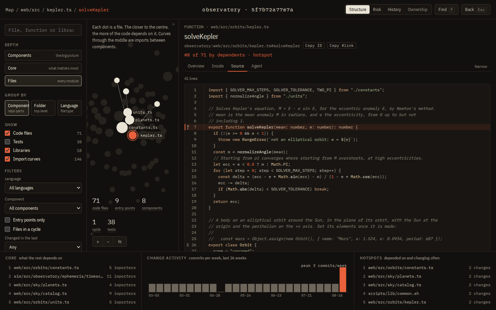
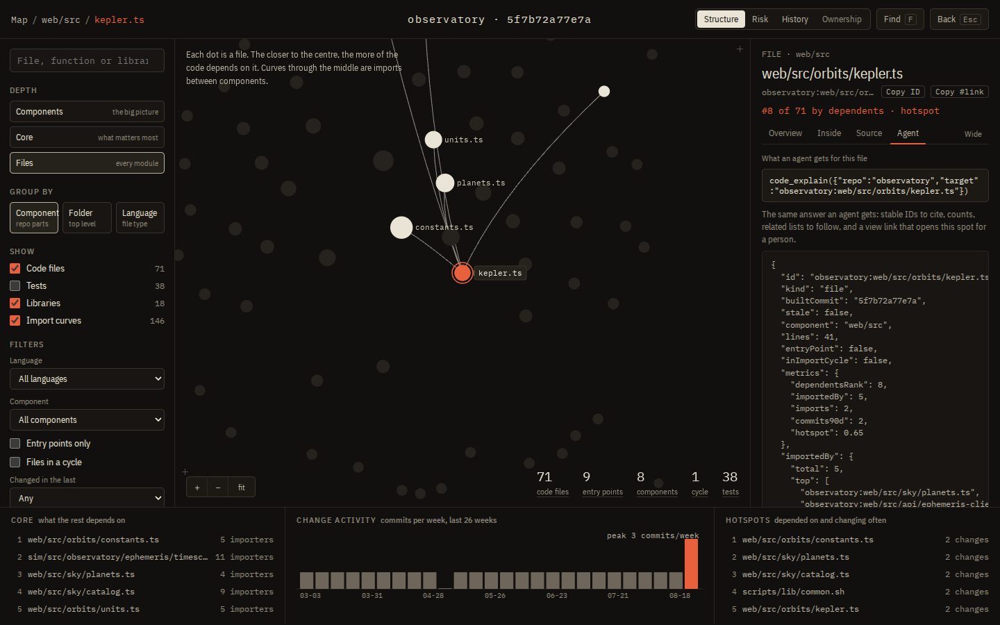

Author: d3vn0mi.

# The design

This page sets out what hakutaku is for, how it is built and the rules it keeps. Where a detail is a
contract, the [agent interface](tools.md) and the [viewer guide](viewer.md) give it in full, and the
[security model](security.md) gives every control against a hostile repository.

Every example uses `observatory`, the synthetic sample in
[`fixtures/observatory/`](../fixtures/observatory/). Every number comes from the sample, from the
scale generator ([`fixtures/scale/generate.mjs`](../fixtures/scale/generate.mjs)), or from one public
repository, marimo-team/marimo at `b0e402345e0a`, measured before hakutaku was built, by a prototype
of the same pipeline in a resource-capped run.

## Intent

hakutaku maps a git repository into one SQLite store, and answers questions about it through an MCP
server, a CLI and a local viewer.

- **What the store holds:** files, imports, definitions, labelled callers, metrics, entry points and
  recent history.
- **One source for every answer.** Every answer, for an agent or a person, comes from the same store
  through the same query functions.

**Agents first.** An agent, which may have no shell at all, needs answers that are precise,
labelled, small and citable:

- where X is defined;
- who calls it;
- what breaks if it changes;
- which files matter most.

In practice, "agents first" means:

- the tool contract is designed, tested and frozen before the viewer;
- every inferred answer is labelled, and every blind spot is named;
- unknowns are refused, never guessed;
- answers are capped and paged;
- IDs can be quoted back;
- the viewer is a client of the agent tools, never the other way round.

**Humans second.** The same map, drawn. A person new to a repository sees in minutes:

- what the code depends on;
- where it starts running;
- what changes often;
- what changes together.

The viewer is a window onto the agent answers, not a second model of the code: its Agent tab shows
the exact JSON an agent gets for the node on screen.

**Why build it.** The engines exist: compiler indexers that bind each call to the one definition it
reaches, an import graph for each language, and structural search. The rest did not: one store that
holds the union of their answers, a label on each answer that says how it was found, tools whose
contract an agent can trust, and a viewer that shows those same answers.

**Why public.** Nothing in the engine is specific to one codebase. Publishing it under MIT keeps a
clean line between the generic tool and what a host keeps of its own: its policy, its layout
profiles, its rules and its stores. It makes the tool usable on any repository, and invites review.

**One tool for any repository.** Install it once, then map any git checkout with
`hakutaku map <repo>`.

**The name.** Hakutaku (白沢) is the Japanese name of the Baize (白澤): in Chinese lore, a beast that
knew all things and described every kind of creature so that it could be catalogued. That is what
the tool does for a codebase, by reading it, never by running it. The viewer draws a repository as
a sky:

- what everything depends on, at the centre;
- the components, in a ring around it;
- the libraries, in orbit outside.

## Goals, non-goals and anti-goals

### Goals

1. **Map everything.** Point hakutaku at a repository, and get every tracked code file with its
   imports, definitions, callers, metrics and entry points. This takes seconds at quick detail and
   minutes at most at standard detail.
2. **Agent answers that can be trusted.**
   - Every caller is labelled with how it was found.
   - Unknown targets are refused, and ambiguous names return candidates.
   - IDs are stable and can be cited.
3. **One store per repository.** It is built offline and is deterministic: the same inputs give the
   same store content. The inputs are the commit, the versions, the profile and rules, the detail,
   and whether sources are stored.
4. **One contract, three faces.** The MCP tools, `hakutaku query` and any host that embeds the library
   share tool names, inputs and outputs. The viewer shows the same answers.
5. **A viewer for a first look,** with a choice of depth, search and filter, and highlighted source,
   for TypeScript, JavaScript and Python.
6. **Safe on hostile repositories.** Nothing from the analysed repository ever runs, and no secret
   enters the store.
7. **Public and attributed.** MIT, and a [NOTICE](../NOTICE) that credits every upstream project.
   Examples and numbers come only from the synthetic sample and from public repositories.
8. **Cheap to add a repository.** A generated profile that a person reviews, and no dependency
   install.

### Non-goals in v1

- Security analysis proper, such as taint and data flow. That is a later phase.
- Writing code. There are no edit, refactor or fix tools.
- Model calls of any kind. hakutaku does no summarising.
- Questions across repositories, pull request impact (`code_pr_impact`) and the Ownership lens.
  These come later.
- Precise callers beyond TypeScript, JavaScript and Python. Shell is matched by name only, and other
  languages appear as files.
- Per-file incremental extraction, because neither SCIP indexer has it.
- A hosted service or a multi-user server.
- Windows.
- An MCP transport other than stdio.

### Anti-goals, refused even if asked

- **Leaking the code or metadata of the repositories it maps:** stores and snapshots stay on the
  machine, never in the analysed repository or in hakutaku's own.
- **A viewer that looks good but answers agents worse.**
  - No viewer feature may change, simplify or slow an agent answer.
  - Layout never feeds a tool.
  - The viewer calls the agents' query functions, not the other way round.
- **Extraction that runs code from the analysed repository.** That includes its JavaScript configs,
  its interpreter settings, its git filters and hooks, its package scripts, and its `setup.py` or
  `conftest.py`.
- **A name match presented as a fact**, or any answer about something that is not in the store.
- **A tool that opens what a model names.** No tool takes a filesystem path, glob or URL from a model
  and opens it.
- **Talking to the outside.** No telemetry and no update checks, and the viewer loads nothing from
  outside the machine.

## Users and the first run

### Users

| User | Through | Wants |
|---|---|---|
| An agent in any MCP client | `hakutaku mcp`, over stdio | Precise, small, citable answers |
| An agent in a host that embeds the library and applies its own policy | The library, in process | The same answers, under the host's policy |
| A person new to a repository | The CLI and `hakutaku view` | A first look at a repository, then a quick way into any file |
| A host that runs its own builds | `hakutaku export`, `hakutaku extract` and `hakutaku engines install` | Builds that run inside its own sandbox and on its own schedule |

### The first run: the CLI

Install hakutaku once, globally, outside any repository. To try it on the sample, write the sample
first, from a clone of this repository, then map it:

```sh
node fixtures/observatory/make.mjs <dir>
hakutaku map <dir>/observatory
```

1. **Engines.** On first use, hakutaku names the engines it needs and asks before fetching them:
   > hakutaku needs scip-typescript, dependency-cruiser and ast-grep (npm) and grimp (PyPI). Install the pinned versions now? [y/N]
   - `--yes` answers for scripts.
   - The engines are installed once for each engine lock, hash-checked, into the user's data
     directory ([Engines are installed, not depended on](#engines-are-installed-not-depended-on)).
   - Without a Python that grimp can run under, Python imports come from hakutaku's own resolver
     instead. The store records which resolver found each import, and the answers' `blindSpots`
     say so.
2. **Profile.** hakutaku reads the repository's manifests as data, and writes a layout profile:
   TypeScript path aliases, Python import roots, components, test patterns and extra launch
   manifests. It prints what it found. For the sample:
   ```text
   aliases 2 · python roots sim/src · components plugins/, scripts/, sim/, sim/src/observatory/, web/, web/app/, web/scripts/, web/src/ · launch manifests 10
   ```
   It stops on a conflict rather than guess, as when two packages export the same name, and asks
   for one to be named in the profile.
3. **Build.** Export the commit, extract it in a sandbox, check the gates, and swap the new store in.
4. **Summary.** What `map` printed for the sample, on Linux with bubblewrap, at the commit
   `make.mjs` writes:
   ```text
   hakutaku 0.1.0 · observatory at 5f7b72a77e7a (HEAD), standard detail
     files      143 tracked · 109 code (TypeScript 65, Python 37, shell 4, JavaScript 3) · 71 production, 38 test
     imports    146 edges · 0 unresolved relative · 1 cycle
     callers    1,126 call sites · 191 bound · 160 scoped · 775 unresolved
     entry      13 entry points from 11 launch manifests
     core       24 of 71 production files (34%) carry at least half of what the code depends on
     built      2 s · peak 0.3 GB · store 0.9 MB · sandbox: bubblewrap
   next  hakutaku view observatory    the map, in your browser
         hakutaku mcp observatory     the tools, for an agent
   ```

**Choosing detail.** `--detail` chooses how much is extracted, and the viewer's depth levels choose
how much is shown.

| Detail | Adds | Cost |
|---|---|---|
| `quick` | Imports, definitions, `scoped` callers, metrics, entry points, the text index and sources | Seconds; no compiler runs |
| `standard`, the default | Compiler-bound TypeScript and JavaScript callers and references, from scip-typescript | On marimo-team/marimo at `b0e402345e0a`: 64.8 s, a peak of 1,099 MB and a store of 194 MB |
| `deep` | Compiler-bound Python callers, from scip-python | Opt-in, with a memory cap |

### Then the viewer

`hakutaku view observatory` serves the map on `127.0.0.1` and prints a link that carries a session
token. `--open` also opens it in the browser.

A newcomer sees:

- the stat band: code files, entry points, components, cycles and tests;
- the galaxy, with a one-line legend;
- the Core, Change activity and Hotspots lists.

From there:

- They choose how deep to look: Components, Core, Files, then a file's Definitions and its Source.
- Find [F] reaches any file, definition or library by name.
- Back [Esc] climbs one level.

### Then the agent

An MCP client starts `hakutaku mcp observatory`, over stdio. [Setting it up](tools.md#setting-it-up)
gives the client's configuration. An agent calls the tools in this order:

1. `code_repos`: what it may ask about, and how fresh each repository is;
2. `code_overview`: the core, the entry points and the hotspots;
3. `code_explain`, `code_callers` and `code_snippet`, on whatever it needs.

**The `view` field.**

- **One node.** `view` is the last field of every answer about one node: `code_overview`,
  `code_explain`, `code_callers`, `code_references`, `code_deps`, `code_snippet`, and `code_path`,
  where it names the `from` node. A person who opens it in the viewer sees the node the agent cited.
- **Lists.** List answers carry none: `code_repos`, `code_find`, `code_search_text`, `code_rules` and
  `code_impact`. Their items carry IDs, and an ID converts to a token.

### All commands

| Command | What it does |
|---|---|
| `hakutaku map <repo> [--id <id>] [--ref <ref>] [--detail quick\|standard\|deep] [--no-source] [--no-snippets] [--sandbox auto\|require\|none] [--engines-dir <path>] [--yes]` | Profiles the repository if it has no profile, then runs export, extract, the gates and the swap. Registers the repository |
| `hakutaku view <id> [--open] [--export <file.html> [--with-source]]` | Starts the viewer, or writes one self-contained page |
| `hakutaku mcp <id>... \| --all [--allow-refresh]` | The MCP server over stdio, serving exactly the repositories named |
| `hakutaku query <tool> <id> [--args '<json>']` | Any tool, from a shell. The JSON is the same as over MCP |
| `hakutaku list [--json]` | The registered repositories, their commits and their freshness |
| `hakutaku profile <repo> [--ref <ref>] [--out <file>]` | Generates or regenerates the profile, for review |
| `hakutaku engines install\|list\|verify [--engines-dir <path>] [--deep] [--yes]` | Manages the pinned engines, in the default directory or in `<path>`. Installing is the only networked step |
| `hakutaku export <repo> --ref <ref> --out <dir> [--id <id>] [--profile <file>] [--rules <file>] [--max-files <n>]` | Stage 1 alone. It writes one directory: the snapshot, the history, and copies of the profile and rules. Hosts call this |
| `hakutaku extract <dir> --out <store> [--engines-dir <path>] [--detail quick\|standard\|deep] [--no-source] [--sandbox auto\|require\|none] [--memory-max <size>]` | Stage 2 alone: the engines and the store. It reads only the export directory and the engines. Hosts call this inside their sandbox |
| `hakutaku doctor` | Checks Node, Python, the engines and whether a sandbox is available |

## Architecture

### The pipeline

```text
 source repository: a git checkout, never written
        │
        │  hakutaku export     reads git objects at one commit (ls-tree, cat-file --batch),
        │                      plus git log for history; no filters, hooks, fsmonitor, pager or signatures
        ▼
 snapshot/ (read-only; tracked files only; denylisted files removed)  +  history.json
                              +  copies of the profile and rules  +  the engines' generated configs
        │
        │  hakutaku extract    no network, no git, no repository config honoured; reads only this
        │                      directory and the engines
        │                      scip-typescript · dependency-cruiser · grimp · ast-grep · (scip-python)
        ▼
 store.sqlite + build.json     gated, then swapped in atomically; the previous store is kept
        │
        │  query layer         pure functions over a read-only store: no processes, no sockets
        ▼
 MCP server (stdio) · hakutaku query · viewer server (127.0.0.1) · a host that embeds the library
```

The two stages are separate on purpose.

- Export needs git and reads the source repository.
- Extract needs neither, and runs the parsers over untrusted input.
- So a host can give each stage a sandbox of its own.

### What hakutaku contains

hakutaku is one npm package, `hakutaku`, with four parts:

- **`hakutaku`**, the library: `openStore`, the tool specs and `runTool`, the `Host` interface, the
  viewer's API, and the types.
- **`hakutaku/build`**, for build hosts: `exportRepo`, `extractSnapshot` and `generateProfile`.
- **The `hakutaku` command.**
- **The viewer**, prebuilt, as static assets.

Inside the package:

| Module | Holds |
|---|---|
| `export/` | The hardened git reader, the snapshot writer and the history reader |
| `extract/` | The sandbox, the engine runner, one driver per engine, the merge of their answers, the metrics and the gates |
| `engines/` | The engine lock, the install and its verification, and where the engines live |
| `store/` | The schema, the writer, and the reader on `node:sqlite` |
| `model/` | IDs, link tokens, labels and the metric algorithms |
| `manifests/` | The launch-manifest readers |
| `profile/` | The profile and rules formats, and the profile generator |
| `redact/` | The denylist and redaction |
| `registry/` | The registered repositories, the build lock, the refs read as data, and the `Host` that the MCP server and the viewer use |
| `query/` | One pure function per tool, and the viewer's data |
| `tools/` | The tool specs (name, description and input schema), paging, errors and the `Host` |
| `mcp/`, `viewer/`, `cli/` | The three faces |

**Dependencies and requirements.**

- The library's runtime dependencies stay small: the MCP SDK, and nothing that parses code.
- ast-grep runs as its CLI, installed from the engine lock. It is never loaded in process, so the
  line above stays true.
- It needs a Node version where `node:sqlite` needs no flag and its SQLite has FTS5: 22.16 and later.
  22.13 to 22.15 lack FTS5.
- Python 3.10 or later, with pip, is needed for grimp.

### Engines are installed, not depended on

`hakutaku engines install` reads `engines.lock.json`, which ships in the package.

- **What the lock holds:**
  - exact versions, with integrity hashes, for the npm engines: scip-typescript 0.5.2,
    dependency-cruiser 17.4.3 and ast-grep's CLI 0.51.1, with the TypeScript 6.0.3 they run, and
    scip-python 0.6.8, which is installed only for deep detail;
  - grimp 3.18's wheels, installed with `--only-binary=:all: --require-hashes`.
- **Where they go:** `$XDG_DATA_HOME/hakutaku/engines/<the first 16 hex digits of the lock's hash>/`
  by default. `--engines-dir` names another directory, for a host that pins its own install.
  `hakutaku engines`, `hakutaku map` and `hakutaku extract` all take it.
- **Why they are not npm dependencies:**
  - A host that only queries must not pull a TypeScript compiler and Pyright into its dependency
    tree.
  - The install is the one networked step, and this keeps it apart from extraction.
- **The pin rule:**
  - pin only releases that have been out for at least two weeks;
  - verify their checksums or provenance;
  - run the acceptance suites again on exactly the pinned versions.
- **A version constraint.** dependency-cruiser's major versions follow Node's, so the lock pins a
  major that runs on every Node version hakutaku supports.

### Host hooks

Every face of hakutaku runs the same tool functions through a `Host`:

```ts
interface Host {
  repos(ctx: CallContext): RepoEntry[]; // the repos this caller may ask about
  open(ctx: CallContext, repo: string): Store | HostError; // exact id match, never a path
  freshness(repo: string): Freshness; // { headCommit, stale, reason? }
  snippets(repo: string): boolean; // source lines on or off
  refresh?(repo: string): RefreshState; // absent: code_refresh answers refresh_disabled
  maxResultChars: number; // 40,000 unless the host sets its own
}
```

- **`CallContext` is opaque to hakutaku.** hakutaku passes it back to the host and never reads it,
  so a host can carry whatever names its caller.
- **hakutaku's MCP server** builds its `Host` from the registry and its flags.
- **A host that embeds the library** builds one from its own policy.

### The boundary

1. **Dependencies point one way.** A host depends on hakutaku, and hakutaku never names a host.
   Beyond the opaque `CallContext`, hakutaku has no notion of who is asking.
2. **A host keeps its policy as data:** who may ask about which repository, its layout profiles, its
   rules, its build schedule and its sandbox.
3. **What crosses the line:**
   - the npm package (`openStore`, the tool specs, `Host`);
   - the CLI;
   - the profile and rules file formats;
   - the store schema.

## Data model

### Nodes

| Node | What it is | ID |
|---|---|---|
| repository | One analysed repository at one commit | `observatory:` |
| component | A directory that groups files: a package root, a Python package or a top-level folder | `observatory:web/src/orbits/` |
| file | A tracked file. Its kind is code, test, test-support, config, doc or other | `observatory:web/src/orbits/kepler.ts` |
| definition | A function, class, method, constant or type. Types include interfaces, aliases and enums | `observatory:web/src/orbits/kepler.ts#Orbit.position` |
| module scope | The code at a file's top level, treated as a pseudo-definition | `observatory:web/src/orbits/kepler.test.ts#<module>` |
| external module | A package or standard module the repository imports | `observatory:npm:react`, `observatory:pypi:pytest`, `observatory:node:fs` |

**File kinds.**

- Code, test and test-support files are on the map.
- Config files and docs are in the text index.
- Launch manifests are parsed as well.

**Tests.**

- **The default patterns**, which the profile can extend: `*.test.*`, `*.spec.*`, `test_*.py`,
  `*_test.py`, `conftest.py`, and anything under `__tests__/`, `tests/`, `test/` or `fixtures/`.
- **Test support** is a file, not itself a test, that only tests or test support import. The rule is
  applied again until nothing changes.
- **Entry points are exempt.** The test-support rule never applies to an entry point: a file that a
  launch manifest starts stays production, even when only its test imports it.
- A test file is never an entry point.

**Components.**

- A component is the nearest package root: a directory with `package.json`, `pyproject.toml` or
  `setup.cfg`, or a top-level Python package. Failing that, it is the top-level folder.
- A component that holds more than 40% of the production files splits one level down.
- The profile can list component roots instead.
- The `component` field in answers is the component's path without the trailing slash.

### Edges

| Edge | From and to | Carries | Producer |
|---|---|---|---|
| import | File to file, or file to external module | The kind: static, dynamic, type-only, re-export, require, side-effect, source (shell), or exec (a script run by its path). Also the line and the specifier | dependency-cruiser, grimp, ast-grep (shell), hakutaku's own resolver |
| call | Call site to definition | A label (bound or scoped) and `collision` | scip-typescript, scip-python, ast-grep with the import edges |
| reference | Use site to definition | A role: read, write, type, import or other | SCIP |
| contains | Component to file to definition to nested definition | — | The outline |
| co-change | File to file, both ways | The number of shared commits | History |
| launches | Launch manifest to entry file, or entry definition | The manifest line and the kind | The manifest readers |

Imports, call sites, references and definitions each record which producer wrote them, and a call's
label says which tier bound it. `unscoped` matches, and the transitive `scoped` matches, are not
stored: the query layer derives them from the call sites and the imports.

### Definitions

- **Kinds.** Function, class, method, constant and type. In Python these are `def`, `class`, methods,
  and upper-case module-level assignments, taken as constants.
- **Fields:**
  - the qualified name: `Orbit.position`, or `outer.inner` for a nested function;
  - the range and the enclosing range;
  - `exported`. In TypeScript and JavaScript, an exported name, or a public member of an exported
    class. In Python, a name that does not start with `_`, in a module that something imports;
  - the parent definition;
  - the SCIP symbol, where SCIP has one;
  - a one-line signature, redacted;
  - the producer.
- **The outline mints every ID.**
  - ast-grep's outline runs at every detail level, and it always mints the qualified name and the ID.
  - SCIP's definitions are joined to the outline's by range, which adds the SCIP symbol.
  - A SCIP definition that matches no outline definition gets no ID, and is counted in coverage. A
    bound use of it is counted there too, rather than attached to a guess.
  - So a commit yields the same IDs at quick, standard and deep detail, and also when scip-typescript
    fails and the fallback runs.
- **Module scope.** Code at a file's top level belongs to `#<module>`. A call inside an anonymous
  callback, such as an `it()` block, belongs to the nearest named definition, and otherwise to
  `#<module>`.

### Stable IDs

```text
repo-id     [a-z0-9][a-z0-9._-]{0,63}
repo        <repo-id>:
file        <repo-id>:<path>                          observatory:web/src/orbits/kepler.ts
directory   <repo-id>:<path>/                         observatory:web/src/orbits/
definition  <repo-id>:<path>#<qualname>[(<n>)]        observatory:web/src/orbits/kepler.ts#Orbit.position
module      <repo-id>:<path>#<module>                 observatory:web/src/orbits/kepler.test.ts#<module>
external    <repo-id>:<ecosystem>:<name>              observatory:npm:react, observatory:pypi:pytest
```

- **The path** is exactly as git tracks it, with `/` separators and case kept. `%`, `#`, `:` and
  control characters are percent-encoded, so:
  - the first `:` ends the repo id;
  - a second, unencoded `:` marks an external module;
  - the first `#` starts the definition.
- **`(n)`** appears only when one file defines the same qualified name more than once, as conditional
  definitions do. `n` counts from 2, in file order. A TypeScript overload's signatures and its
  implementation are one definition.
- **Stability.** An ID stays the same across builds as long as the path and the qualified name do.
  - Neither the detail level nor a failed compiler tier changes it, because the outline mints every
    ID.
  - A rename gives a new ID. The old ID then answers `not_found`, with candidates: the same qualified
    name elsewhere, and any rename seen in the last 180 days of history.
- **The SCIP symbol** is kept beside each definition, for joins across repositories later. It is not
  the public ID, because it is long and hard to read.
- **The ecosystem is part of an external module's ID:** `npm`, `pypi`, `node` or `python`. So a
  library never collides with a folder of the same name, such as `lib/`.

### Link tokens

A link token is the URL fragment that opens a node in the viewer.

| ID | Token |
|---|---|
| `observatory:web/src/orbits/kepler.ts` | `web~src~orbits~kepler.ts` |
| `observatory:web/src/orbits/kepler.ts#Orbit.position` | `web~src~orbits~kepler.ts--Orbit.position` |
| `observatory:web/src/orbits/` | `web~src~orbits~` |
| `observatory:npm:react` | `npm:react` |

The repository itself, `observatory:`, has an empty token, so its `view` is `#`. `view` is `#`
followed by the node's token, and `code_refresh` carries none.

**Encoding.** One function, `enc`, applies to each part of an ID: a path, a qualified name, or an
external module's name. It takes each part raw, as git tracks the path, without the ID's own escapes.

1. Percent-encode every character except `A` to `Z`, `a` to `z`, `0` to `9`, `.`, `_`, `-` and `/`,
   as its UTF-8 bytes in upper-case hex. That covers `~`, `:`, `#`, `%`, `@`, spaces and anything
   outside ASCII.
2. Percent-encode, as `%2D`, every `-` that is followed by another `-` or that ends the part.
3. Turn every `/` into `~`.

The token is then:

- for a file or a directory: `enc(path)`. A directory's path keeps its trailing `/`, so its token
  ends in `~`;
- for a definition: `enc(path)`, then `--`, then `enc(qualname)`;
- for an external module: the ecosystem, then `:`, then `enc(name)`;
- for the repository: nothing.

**Decoding.**

1. An empty token is the repository.
2. A token that holds a `:` is an external module. The ecosystem is what precedes the `:`.
3. Otherwise the first `--`, if there is one, separates the path from the qualified name.
4. In each part, every `~` becomes `/`, and only then are the percent escapes decoded.
5. A path that ends in `/` is a directory.

**Why one token gives one ID.**

- After `enc`, a part holds no `:` and no `--`, and does not end in `-`.
- Each `~` in it stands for a `/`, and each `%` starts an escape.
- So the first `--` of a definition's token is always the separator, and every other rule has
  exactly one inverse.

**Two worked examples.**

1. **`observatory:web/src/orbits/kepler.ts#Orbit.position`.**
   - Encoding. No character needs an escape, and no `-` is doubled or last. Turning each `/` into
     `~` gives `web~src~orbits~kepler.ts` and `Orbit.position`, so the token is
     `web~src~orbits~kepler.ts--Orbit.position`, as in the table.
   - Decoding. There is no `:`. The first `--` follows `kepler.ts`. Each `~` becomes `/`, and nothing
     is escaped. That gives back the same ID.
2. **A path that ends in `-`:** the function `main` in the script `scripts/sync-`, whose ID is
   `observatory:scripts/sync-#main`.
   - Encoding. The last `-` ends the path, so the second rule makes it `%2D`. That gives
     `scripts~sync%2D`, and the token is `scripts~sync%2D--main`.
   - Decoding. There is no `:`. The first `--` follows `%2D`, so the parts are `scripts~sync%2D` and
     `main`. `~` becomes `/`, then `%2D` becomes `-`, which gives back `scripts/sync-` and `main`.
   - Without the second rule, the token would be `scripts~sync---main`. Its first `--` gives the path
     `scripts/sync` and the name `-main`: the wrong file.

**More cases**, which the tests check with every node of the sample and with generated odd paths:

| ID | Token | What it shows |
|---|---|---|
| `observatory:web/a--b/c.ts` | `web~a%2D-b~c.ts` | an inner `--` |
| `observatory:notes~old/x.md` | `notes%7Eold~x.md` | a literal `~` |
| `observatory:tools/foo-/` | `tools~foo-~` | a directory whose name ends in `-` |
| `observatory:npm:@types/node` | `npm:%40types~node` | a scoped npm name |
| `observatory:web/src/orbits/kepler.test.ts#<module>` | `web~src~orbits~kepler.test.ts--%3Cmodule%3E` | module scope |

**In the viewer.**

- It reads the token on load and on `hashchange`, from the fragment exactly as it stands.
- It splits the token first and decodes each part afterwards, so a `%2D` can never turn back into
  part of a separator.
- It has Copy ID and Copy #link buttons.
- It writes the token of every selection into the address bar.
- **Tokens are relative.** A host that serves the viewer at a known address can turn a token into a
  full link for people. The JSON keeps the token.

There is no fallback by index: a token never names a node by its place in a list, which would change
whenever files are added.

### Metrics

| Metric | Definition |
|---|---|
| PageRank and `dependentsRank` | Computed over production import edges, from importer to imported, including type-only imports. Tests, test support and their edges are left out. Damping is 0.85, and dangling mass is spread evenly. It iterates until the L1 change is below 1e-10, or for 100 rounds, with ties broken by path. `dependentsRank` 1 is the most depended-on production file, and tests get `null` |
| Core set | The shortest run of production files, in rank order, whose PageRank adds up to at least half of the PageRank. Each component's top file is then added, so that no component drops out, and the set still carries at least half. Its share is always taken of the production files. Reported as, for the sample, "24 of 71 production files (34%) carry at least half of what the code depends on" |
| Fan-in, fan-out | The number of repository files that import this file, and the number it imports |
| Churn (`commits90d`) | The commits that touch the file in the 90 days before the built commit's committer date, on that commit's history |
| Co-change (`changesTogetherWith`) | Uses the commits in the 180 days before the built commit that touch between 2 and 30 code files. A file's partners are the files that share at least 2 of those commits with it. The store keeps the top 8, and `code_explain` shows 6 |
| Hotspot | √(PageRank ÷ max PageRank × churn ÷ max churn), for production files only, then divided by the repository's largest such value, so the top hotspot is 1.00. Two decimals |
| Cycles | Tarjan's strongly connected components over production runtime imports, so type-only imports are left out. Written as a loop, not recursion, because deep graphs overflow the stack. Each cycle has a shortest closing chain, with lines |
| Used by (`usedByFiles`) | For each definition: the production files, other than the defining one, that have a bound or scoped call site, or a SCIP reference, to it |
| Mentioned by tests (`mentionedByTests`) | True when a test or test-support file has a bound or scoped use of the definition. Where no compiler tier ran, it is also true when such a file uses the name while importing the defining file. This is a mention, not coverage: hakutaku never runs tests |
| Timeline | Commits per week, over the 26 weeks before the built commit |

**Anchored windows.** Every window counts back from the built commit's committer date, never from
the day of the build, so the store depends only on the commit.

### Entry points from launch manifests

| Manifest | Yields | Kind |
|---|---|---|
| `package.json` `bin` | The file each command runs | `bin` |
| `package.json` `scripts` | Repository files named in a command: `node x.mjs`, `tsx src/cli.ts`, `python -m pkg.mod`, `bash scripts/x.sh` | `script`. Test, lint, build, format and typecheck scripts are `dev-script`, listed apart |
| systemd units in the repository: `*.service`, and a `*.timer` through its service | Repository files in `ExecStart`, `ExecStartPre`, `ExecStartPost`, `ExecReload` and `ExecStop`, matched by suffix against tracked paths, so `%h/…` and absolute prefixes do not matter | `unit` |
| `pyproject.toml` `[project.scripts]`, `[project.gui-scripts]`, `[project.entry-points.*]` and `[tool.poetry.scripts]`; `setup.cfg` `console_scripts` | `module:function`, mapped to the file and the definition. `setup.py` is never run | `console-script` |
| `Dockerfile` `CMD` and `ENTRYPOINT`; `Procfile`; CI workflow `run:` lines | The repository files they run | `container`, `procfile`, `ci` |
| Plugin manifests, declared in the profile as `{ glob, pointer }` | The module the pointer names | `plugin` |
| Secondary signals | An executable file with a shebang (git mode 100755); `__main__.py`, and `if __name__ == "__main__":`; framework routes (Next.js `app/**/page` and `route`, `pages/**`) when the framework is a dependency | `executable`, `main-guard`, `route` |

- **Built paths.** A path to a built file, such as `./dist/index.js`, is mapped back to its source.
  `outDir` and `rootDir` are read from the tsconfig, as data, and paths under `dist/`, `build/` or
  `lib/` are also tried under `src/`, with the TypeScript extensions.
- **Plugin manifests stay generic.** A host's own plugin format becomes an entry point without
  hakutaku knowing the host: the profile declares where such manifests sit and which field names the
  module, as the sample's profile does for its `plugins/*/plugin.json`.
- **Every entry point records the manifest and the line that launches it**, so an answer can say why
  the file counts.

### The store

There is one SQLite file per repository per build. Its tables, and the columns of each:

```text
meta            schema_version, hakutaku_version, repo_id, commit_sha, commit_time, detail, no_source,
                engines (JSON), engine_lock_hash, profile_hash, rules_hash, coverage (JSON), gates (JSON)
run             ref, content_hash, built_at: the run, outside the content hash
components      id, path, kind, parent_id, files, tests, lines
files           id, path, lang, kind, component_id, lines, bytes, blob_sha, mode, link_target, entry,
                has_source
sources         file_id, body (compressed, redacted)
definitions     id, file_id, qualname, ordinal, name, kind, start_line, start_col, end_line, end_col,
                exported, parent_id, scip_symbol, signature, producer
externals       id, ecosystem, name, files
imports         id, src_file_id, dst_file_id, dst_external_id, kind, line, specifier, resolved, producer
call_sites      id, file_id, line, col, enclosing_def_id, callee_name, receiver_text, producer
call_targets    site_id, def_id, label, collision
refs            id, file_id, line, col, enclosing_def_id, def_id, role, producer
entry_points    file_id, def_id, kind, manifest_file_id, manifest_line, name
file_metrics    file_id, pagerank, dependents_rank, fan_in, fan_out, churn_90d, hotspot, cycle_id, core,
                last_change
def_metrics     def_id, used_by_files, used_by_files_bound, mentioned_by_tests
cochange        file_id, partner_file_id, commits
cycles          cycle_id, ord, file_id, line
rule_findings   id, rule, severity, from_file_id, to_file_id, chain (JSON), producer
timeline        week_start, commits
renames         old_path, new_path, commit_sha
text_index      FTS5, with the trigram tokenizer: every non-empty line of every stored source, redacted
```

- **`build.json`** sits beside the store and holds what varies from run to run: the build's start and
  end, its wall time and peak memory, each engine's wall and CPU time, peak memory and exit code,
  the warnings, and the sandbox used.
- **Determinism is claimed over the content tables.**
  - The content tables are every table except `run`. `run` holds the ref the build was asked for,
    which is not content: two refs can name one commit.
  - The same inputs give the same content, on any SQLite version. Rows are inserted in a fixed order,
    so even row ids match.
  - The content hash is a SHA-256 over a canonical dump of the content tables. The build records it
    in `run`.
  - The file as a whole is not claimed to be byte-identical: `run` changes with the ref.
- **Sources are in the store**, redacted. So:
  - snippets and the viewer's source view never touch the file system;
  - the store is self-contained;
  - a string from a model can never become a file read.

  With `--no-source`, sources are left out, and the snippet tools answer `no_source`.
- **Size.** The sample's store is 0.9 MB. On marimo-team/marimo at `b0e402345e0a`, a whole store, with
  call sites, sources and the text index, measured 194 MB.
- **Engine outputs**, such as `index.scip` and dependency-cruiser's JSON, are temporary, and are
  deleted once the store is written.

### Freshness and rebuilds

- **What every answer about a repository's content carries:** `builtCommit` and `stale`.
- **What `stale` means.** It is `true`, `false` or `"unknown"`. It is `true` in two cases:
  - The ref has moved past `builtCommit`. The host reports this through `freshness`.
    - hakutaku's own `Host` reads the ref as data, with no git process. It reads `.git/HEAD`, the
      loose refs under `refs/`, and `packed-refs`, in git's own lookup order for a ref name.
    - It follows a `.git` file's `gitdir:` and a linked worktree's `commondir`.
    - It caches each answer until something the answer depends on changes, and it checks those paths
      on each call: the modification time of every file it read, and whether a loose ref it looked
      for, and did not find, now exists. The second check matters after `git gc`: a ref resolved from
      `packed-refs` can come back as a new loose file on the next fetch, while `packed-refs` keeps its
      modification time.
    - A ref it cannot resolve to a commit that way gives `stale: "unknown"`, with the reason, as a
      reftable store does.
    - So the MCP server still starts no process after start-up.
  - The last build failed, or failed its gates. The previous store then keeps serving, and the reason
    is given.
- **Where the reason goes.** `code_repos` gives it, in `staleReason`. Other answers carry `stale` alone.
- **Skipping a build.** No build runs when all of these match the current store: the schema version,
  the commit, the hakutaku version, the engine lock, the profile's hash, the rules file's hash, the
  detail and the `--no-source` flag. The ref is not among them, so a ref that moves to a commit
  already built costs nothing. A store whose engines ran out of memory is built again when the memory
  cap changes.
- **The gates**, which a new store must pass before it is swapped in:
  - `files-indexed`: the engines indexed the files they were given;
  - `unresolved-imports`: unresolved relative imports stay under the profile's threshold (0.5% by
    default), and do not grow from the current store;
  - `scip-duplicates`: no symbol in scip-typescript's index is defined by two files as their own;
  - `denylist`: no denylisted path is in the store;
  - `redaction`: a second scan of the redacted text finds no secret-looking span.
- **The atomic swap.** The build writes a temporary file in the same directory and runs the gates on
  it. It then renames it over the store, and keeps the old one as `store.prev.sqlite`.
- **Incremental builds.**
  - v1 rebuilds fully on every new commit, since neither SCIP indexer is incremental.
  - Later, an engine's output will be reused when that engine's inputs are byte-identical: its file
    set (blob SHAs), its generated config and its version. A docs-only commit would then re-run only
    the text index and the history metrics.
  - Per-file extraction is a non-goal.

## The agent interface

[The agent interface](tools.md) is the full contract: every tool's arguments and answer, field by
field and in order, every refusal and every limit, with examples from the sample.

**Conventions for every tool.**

- **Names.** The tools are named `code_*`, the same in the MCP server, in `hakutaku query` and in any
  host that registers them. Each tool's spec (its name, description and input JSON Schema) lives in
  hakutaku, and hosts register it unchanged.
- **`repo`** is a repository id, matched exactly against the host's list. It is never a path.
- **Targets** (`target`, `symbol`, `file`, `from` and `to`) take a stable ID, a repository-relative
  path or `path#qualname`, or a bare name.
  - Paths are only looked up in the store's file table. None is ever opened.
  - A bare name with one match resolves. With several, it answers `ambiguous` with candidates, and
    with none, `not_found` with near misses.
  - Resolution is exact: string equality over the store. Fuzzy matching only ever makes candidates.
  - A full ID whose repository is not `repo` is `invalid_argument`.
- **Freshness.** Every answer about a repository's content carries `builtCommit` (12 hex characters)
  and `stale`. `code_repos` carries them for each repository.
- **Locations.** Every location carries an ID and a line. When snippets are on for the repository, it
  also carries `text`: that source line, trimmed, redacted, and at most 240 characters.
- **Lists inside an answer** take the form `{ total, top: [...] }`, with fixed caps.
- **Size and paging.** A result is at most `maxResultChars` (40,000 by default), measured as
  `JSON.stringify(result, null, 2)`.
  - A result that fits comes back whole, with no paging fields, so an answer without them is
    complete.
  - Otherwise it goes out a page at a time: the longest run of whole items that fits, beside
    `offset`, `returned`, `total`, `hasMore`, `nextOffset` while there is more, and a one-line `note`.
    Following `nextOffset` returns each item once, in order.
  - Nothing is cut mid-item. An item whose own list is too large for a page goes out in parts, each
    marked `part: "<k>/<n>"`, and `code_snippet` windows its text in characters, so that following
    `nextOffset` rebuilds it exactly.
- **Order** is deterministic: by rank, then path, then line, unless a tool sets its own.
- **Read-only.** No tool writes anything, except that `code_refresh` asks the host for a rebuild.
- **Never in an answer:** absolute host paths, store paths, environment values or engine command
  lines.
- **Untrusted text.** Everything taken from the repository is data, not instructions: `text`,
  `lines` and signatures, and also paths, names and IDs. Each tool's description says so, the MCP
  server marks every answer that can carry it, and `code_snippet` marks its result `untrusted: true`.

**The tools.**

| Tool | Answers |
|---|---|
| `code_repos` | The repositories this caller may ask about, and how fresh and complete each one is |
| `code_overview` | The core set, components, entry points, hotspots and cycles of a repository; or one component |
| `code_find` | Where something is defined. Exact matches come first, then labelled near misses. Never a single guess |
| `code_explain` | A file or a definition, in one frozen JSON shape. A component or an external module answers `invalid_argument`, with a hint that names `code_overview` or `code_references` |
| `code_callers` | Labelled callers, grouped by the calling definition |
| `code_references` | Uses of a definition that are not calls. For an external module, the files that import it |
| `code_impact` | What a change can reach, hop by hop, with labels |
| `code_deps` | The imports around a file, each with its kind and line |
| `code_path` | The shortest directed path between two nodes, each hop with its line |
| `code_rules` | Cycles and declared layer violations, in one list, each with its chain |
| `code_search_text` | Where a literal appears, in code, config and docs |
| `code_snippet` | Source lines: a definition's range, or up to 120 lines |
| `code_refresh` | Asks for a rebuild, and returns the build state |

**`code_explain` is the exact answer.** Its field names, nesting, order and caps are a contract, and
the golden tests pin it. hakutaku may add a field at the end in a minor version, and documents it
when it does. It never renames, removes or reorders a field.

**The labels.** Every call site says how it was found.

| Label | Meaning |
|---|---|
| `bound` | SCIP resolves the call position to exactly this definition |
| `scoped` | ast-grep finds a call by this name in a file that imports the defining module, directly or through re-exports |
| `unscoped` | A name match with no import link. Returned only when asked for |
| `reference` | A use that is not a call, such as a mock, a dispatch table or a value passed around, from SCIP. `code_references` serves it |

- **`code_explain`'s `label`** sums up a definition's uses, and takes only `bound` or `scoped`, with
  one fixed `note` sentence that says which compiler tiers ran.
- **`collision: true`** marks a scoped site where the calling file can see two or more definitions
  with the name.
- **`scope: "transitive"`** widens scoped matches to files that reach the defining module through any
  chain of imports. It catches callers that reach a method only through an interface type.
- **A hop is only as strong as its weakest link.** A bound caller of a scoped caller is reported as
  scoped.
- **A structural seam, in the sample.** `web/src/sky/render.ts` calls `body.position(t)` on a value
  typed by an interface, so the compiler binds the call to the interface's method. The `scoped` label
  recovers it as a caller of `Orbit.position`.
- **`blindSpots`** comes from the build's coverage: computed `import()` paths, receivers typed by
  packages that were not installed, a compiler tier that did not run, and a language that has no
  callers.

**Snippets.**

- **On by default** for every repository. A host, or the registry (`hakutaku map --no-snippets`), can
  turn them off for a repository.
- **Never shown:**
  - denylisted files, because they are never stored;
  - redacted spans, which show as `«redacted:<rule>»`, with the line numbers kept;
  - files over 1 MB, or detected as minified or generated, which are stored as metadata only and
    answer `no_source`.
- **Bounds.** `text` is at most 240 characters for each location, and `code_snippet` returns at most
  120 lines for each call.

**Errors.** A failed call answers one JSON object, `{ "error": { ... } }`: over MCP the result's one
text block, with `isError: true`.

```json
{
  "error": {
    "code": "ambiguous",
    "message": "2 definitions are named position",
    "candidates": [...],
    "hint": "pass one candidate id as symbol"
  }
}
```

| Code | When | Carries |
|---|---|---|
| `unknown_repo` | The repository is not one this caller may ask about. A host may say so of one that exists, so that a caller learns only of its own | `known`: the caller's repository ids |
| `not_built` | The repository is known, but has no usable store, or its store's schema is newer than this hakutaku | `reason` |
| `not_found` | The target is not in the store | `candidates`: near misses and renames |
| `ambiguous` | A name, or a `path#name`, matches several definitions | `candidates` |
| `invalid_argument` | The input breaks the schema; an ID belongs to another repository; a search text is shorter than 3 characters; or the target is of the wrong kind for the tool | `field`, `hint` |
| `denied_file` | The file is denylisted | — |
| `no_source` | Sources are not stored, or snippets are off | — |
| `rate_limited` | A refresh was asked for too often | `retryAfterSeconds` |
| `refresh_disabled` | The host offers no refresh | — |
| `internal` | Anything else. The message stays generic, and the details go only to the host's log | — |

**The MCP server.**

- **Transport.** stdio only, so no socket listens.
- **Repositories** are fixed at start, from the registry: `hakutaku mcp <id>...`, or `--all`. A model
  cannot add a repository, open a path or switch to another one.
- **Annotations.** `readOnlyHint: true` on every tool except `code_refresh`, and
  `openWorldHint: false` on every tool.
- **Instructions.** The server's `instructions` say what the labels mean, the ID form, the untrusted
  marking, and where to start: `code_repos`, then `code_overview`.
- **No processes, no sockets.** After start-up the server starts no process and opens no socket.
  Freshness comes from reading ref files, not from git. The one exception: a build, when it was
  started with `--allow-refresh` and a refresh is asked for.
- **Stores.** It opens stores read-only, and reopens one when its file has been swapped. It checks
  for that on every call.

## The viewer

The viewer draws a repository as a map that a person can read, search and walk from the keyboard.
[The viewer guide](viewer.md) covers it in full; this is its design in summary.


- **What it is.** A static web app, written in TypeScript and bundled, with no heavy framework. It
  reads a small JSON API over one store: the map, a file's outline, a file's source, the history, and
  the read-only tools, which feed its Agent tab. `hakutaku view` serves it on `127.0.0.1`, and another
  server can serve the same bundle and API under any base path.
- **The map's stack.** hakutaku's own code computes a deterministic galaxy layout, and no layout
  library computes it. sigma.js renders it with WebGL, with graphology as its graph model, and the
  import curves are drawn on an overlay canvas.
- **The layout.**
  - Production files sit on a disc. The radius grows with the PageRank rank, so the most depended-on
    files are at the centre. The angle falls within the group's sector: sectors are sized by file
    count, and files are spread by the golden ratio, with a slight twist.
  - Tests sit on a ring outside the disc, and component hubs on a ring beyond that.
  - Libraries orbit outside everything, each near the mean angle of the files that import it.
  - There is no force simulation, so the same store always draws the same picture, and 20,000 files
    lay out in milliseconds.
- **Curves.** Imports are quadratic curves, bundled through the middle: the control point is pulled
  toward the centre, 0.78 of the way within a group and 0.22 across groups. At Components depth the
  curves are aggregated between hubs, and are thicker where they carry more imports. With a
  selection, only its curves are drawn, and cycle edges are orange.
- **Lenses**, on the keys 1 to 3. Structure shows brightness by rank. Risk shows hotspots and files in
  a cycle in orange, sized by hotspot. History shows brightness by churn over 90 days, and joins a
  selected file to its co-change partners by dashed curves. Ownership is shown, but disabled in v1.
- **Depth levels**, on the D key: Components, hubs only, with aggregated curves; Core, the core set
  plus every entry point, every hotspot above 0.35 and each component's top file, the default above
  400 production files; Files, every production file, the default for smaller repositories; then,
  inside a file, its Definitions, one dot each, and its Source. The breadcrumb always says where you
  are, and Esc climbs one level.
- **Search and filter.** Find (F or /) is one box over files, definitions and external modules,
  ranked by importance, with exact and prefix matches first, in 50 ms over 100,000 items. Filters
  cover language, component, entry points, files in a cycle, recent changes (7, 30 or 90 days) and a
  hotspot threshold. A filter dims what it leaves out rather than moving anything, so the picture
  stays learnable. Every selection writes its link token into the address bar.
- **Inside files.** The details panel has four tabs. Overview gives a node's facts and its lists of
  importers, imports, co-change partners and libraries, every row a link. Inside gives a file's
  definitions, one dot and one row each. Source gives the file's highlighted source, from the
  store's redacted copy, with the selected definition's line flashed and its call sites in the file
  marked by label; a file over 2,500 lines or 16,384 characters is highlighted in a worker, in
  chunks, so that no step blocks the page. Agent gives the exact call an agent would make for the
  node, and the tool's own answer to it.





- **The performance budget**, on a mid-range laptop (4 cores, integrated graphics) running current
  Chrome and Firefox:

  | Production files | First map | Pan and zoom | Find | Tab memory |
  |---|---|---|---|---|
  | Up to 2,000 | 1 s or less | 60 fps | 30 ms or less | 250 MB or less |
  | Up to 20,000 | 3 s or less, at Core depth | 30 fps or more | 50 ms or less | 600 MB or less |

  The map comes as compact arrays. Above 2,000 files, outlines and co-change are fetched on demand,
  and a file's source always is. At most 15,000 curves are drawn in a frame, and labels go through a
  grid.
- **Accessibility.** Everything works from the keyboard. A screen reader cannot read the canvas map,
  so its content also exists as HTML: a list view (L) of the files, ranked, under the active
  filters, the Core and Hotspots lists, the details panel, and a polite live region that announces
  each selection. Colour is never the only signal, text contrast meets WCAG AA, reduced motion turns
  the camera's moves off, and v1 has one dark theme.
- **The server.** `hakutaku view` binds to `127.0.0.1` on a free port. The link carries a random
  session token, which every API call must present, and the `Host` header must be
  `127.0.0.1:<port>` or `localhost:<port>`, against DNS rebinding. There is no CORS, and the server is
  read-only.
- **The static export.** `hakutaku view --export map.html` writes one self-contained page, without
  sources unless `--with-source` is given. The release publishes the sample's page as the public
  demo.
- **Policies and escaping.** The served page runs under a strict Content Security Policy that allows
  its own origin and nothing else, and the exported page under one that allows its one script and
  its one style block by hash. Fonts and libraries are bundled, so neither asks anything of another
  server. The viewer writes no style attribute into its markup, and all repository text is escaped
  before it reaches the page. [The security model](security.md#injected-instructions-and-the-viewer)
  quotes both policies.

An MCP App is planned for 0.2.

## Languages and engines

| Language | Imports, cycles, rules | Callers and references | Definitions | When an engine is missing or fails |
|---|---|---|---|---|
| TypeScript and JavaScript: `.ts`, `.tsx`, `.mts`, `.cts`, `.js`, `.jsx`, `.mjs`, `.cjs` | dependency-cruiser, with an explicit JSON config and the generated tsconfig (`moduleResolution: bundler`). Type-only imports on; no cache | scip-typescript's call sites (`bound`) and references. ast-grep's call sites, scoped by the import edges (`scoped`) | ast-grep's outline, which mints every ID; SCIP's definitions joined to it by range | Imports come from SCIP's module at each specifier, for a file SCIP indexed, and failing that from hakutaku's own resolver over ast-grep's import statements, which says so. Callers are `scoped` only, and `blindSpots` names the gap |
| Python: `.py`, `.pyi` | grimp, run by hakutaku's driver, with the import roots from the profile, the single-file-module overlay, and its cache off | ast-grep's call sites, scoped by grimp's importers. scip-python (`bound`) at deep detail only | ast-grep's outline, which mints every ID; scip-python's definitions joined to it by range, at deep detail | Without a Python, imports come from ast-grep's import statements, resolved by the profile's roots, and say so. Callers are `scoped` |
| Shell: `.sh`, `.bash` | ast-grep rules for `source`, `.`, and scripts run by their repository path, as the kinds `source` and `exec` | ast-grep's calls by function name, within the file and the files that source it | An ast-grep rule for function definitions | The text index |
| Config, units, manifests, docs | — | — | — | The text index. Launch manifests are parsed for entry points |
| Other languages (C, C#, Go, Rust …) | — | — | ast-grep's outline, where it has rules | Files appear on the map, with their lines and history only |

**What each engine contributes.**

- **scip-typescript:** the compiler's binding of each call and reference to exactly one definition;
  definition ranges, joined to the outline's definitions; SCIP symbols, for joins across repositories
  later. It is blind to structural seams, to computed `import()` paths, and to receivers typed by
  packages that are not installed.
- **dependency-cruiser:** import edges, with their kind and line; rule evaluation, for forbidden
  imports and layers; and its own cycle detection.
- **grimp:** the Python import graph, built from declared roots; import chains, layers and impact.
- **ast-grep**, run as its CLI from the engine lock: call sites, with the callee, the receiver text
  and the position; the outline in every language, which mints every definition's ID; string
  literals, which find string-keyed registrations; and the shell rules.
- **scip-python, at deep detail:** Python call binding. It is expensive, so it runs at deep detail
  only, under a memory cap of its own.
- **hakutaku itself:** the resolution the profile drives, the union of the engines' answers and its
  labels, the metrics, the manifests, redaction and the store.

**The layout profile.** `hakutaku profile` generates it, a person reviews it, and the host keeps it
with its own configuration. The sample's:

```json
{
  "schema": 1,
  "components": ["web/src/*", "web/app", "sim/src/observatory/*", "sim/tests", "scripts", "plugins/*"],
  "typescript": { "aliases": { "@obs/web/*": ["web/src/*"] }, "tsconfigs": ["web/tsconfig.json"] },
  "python": { "roots": ["sim/src"], "singleFileModules": [] },
  "tests": { "extraPatterns": [] },
  "launchManifests": [{ "glob": "plugins/*/plugin.json", "pointer": "/entry", "kind": "plugin" }],
  "denylist": { "extra": [] },
  "gates": { "maxUnresolvedRelativeImports": 0.005 },
  "rules": "rules.json"
}
```

- **TypeScript aliases** come from each `package.json` (`exports` mapped to `src`) and from tsconfig
  `paths`, read as JSONC data. An `extends` into `node_modules` is recorded as unresolved.
- **Python roots** are found by walking up from `__init__.py` files. Single-file modules come from
  `pyproject.toml`.
- **Conflicts.** Conflicting aliases stop the generator, rather than let the last one silently win.
- **Never executed.** No repository config is run to build the profile. `tsconfig*.json`,
  `package.json`, `pyproject.toml` and `setup.cfg` are parsed as data.
- **The rules file** declares the layer rules that `code_rules` reports, and the severity of cycles.
  hakutaku compiles it into dependency-cruiser's forbidden rules for TypeScript and JavaScript, and
  into grimp's layer contracts for Python. The sample's forbids an import from `web/src/sky/` into
  `web/src/api/`.

## Security

Analysed repositories may be hostile: people point hakutaku at code they did not write. So every
byte of an analysed repository is treated as data. [The security model](security.md) gives each
control, and how it is checked.

- **Nothing from the analysed repository runs.** Export reads git objects only, with every git call
  hardened, and never uses `git archive`, which can run a filter the repository's config names.
  Symlinks are recorded, never created. The repository's engine configs are removed or never read,
  and hakutaku generates its own. Python runs isolated, and grimp parses files without importing
  them. No package script, install, `setup.py`, `conftest.py` or test runner ever runs.
- **The extraction sandbox.** Extract needs only to read the export directory and the engines, and
  to write its own output. `--sandbox auto`, the default, uses the strongest sandbox available: on
  Linux, bubblewrap, or a `systemd-run --user` service with the same narrow view of the file system
  where bubblewrap does not work. Without either, the build warns and names what is missing, and
  `--sandbox require` fails instead. The environment is built from scratch.
- **Secrets are never stored.** A denylist keeps files such as `.env` and private keys out of every
  snapshot, a redaction pass replaces secret-looking spans before any text enters the store, and a
  gate refuses a store that holds either.
- **Injected instructions and the viewer.** Repository text is marked as untrusted towards models.
  The viewer escapes all of it, under a Content Security Policy that forbids anything that does not
  come from the viewer's own server or, in a static export, from the page itself.

## Acceptance

hakutaku's test suites hold it to these checks, on exactly the pinned engines, and CI runs them on
every push. Each check below says what it holds.

**Engine and store.**

- **Refusals.** An unknown repository, an unknown target and an ambiguous name each get their error,
  `unknown_repo`, `not_found` or `ambiguous`, with candidates where there are any.
- **Isolation and read-only.** Export and extract run as the CLI under strace, which logs every
  socket and connect call of the process and of every process it starts: neither opens a network
  socket. SHA-256 manifests of the repository, `.git` included, and of the export, taken before and
  after, show that nothing in either changed.
- **The sandbox.** The hostile fixtures run a second time, with every extract inside bubblewrap and
  under strace: no exec of a snapshot or fixture file and no internet socket inside it, and at least
  as many sandboxed extracts as there are extract cases.
- **Determinism.** Two builds of one commit give the same content hash, also when two refs name the
  commit. CI builds the sample on each Node version it runs (22.16, the current LTS and the current
  release), each with its own SQLite, and compares the hashes.
- **Gates.** A deliberately broken profile fails a gate, in two cases: a missing Python root, and
  imports resolved `nodenext`-style. The previous store keeps serving, and the failure is recorded as
  the last attempt, so the repository reads as stale, with the reason.
- **Interrupted builds.** A build killed part-way leaves the previous store serving, and the next
  build clears what it left and builds.
- **The sample.** On the synthetic sample, every oracle answer is exact: its files, entry points,
  import cycles, imports, definitions, bound and scoped call sites, references, and every denylisted,
  redacted and computed-import fact, written by hand in
  [`fixtures/observatory/oracle.json`](../fixtures/observatory/oracle.json).

**The MCP server.**

- **Conformance.** An MCP SDK client lists every tool with its schema, and calls each one over stdio.
- **Golden answers.** On the sample, every tool's answer equals a committed golden file, byte for
  byte, `code_explain` included. Over stdio, the MCP server gives the same answers back, byte for
  byte, to the golden calls made on its standard store.
- **Refusals.** An unknown repository, an unknown target and an ambiguous name each give their error
  shape, with candidates where the error carries them. Never a guess.
- **Size and paging.** An oversized answer comes back under 40,000 characters; an answer that fits
  comes back whole, with no paging fields; paging by `nextOffset` returns each item once, in order,
  and every part of a split item; and following `nextOffset` through an oversized snippet rebuilds its
  text exactly.
- **No paths from a model.** Paths, `..`, absolute paths, URLs and globs passed as `repo`, as targets
  and as `path_glob` resolve only through exact IDs. Under strace, the server opens no file outside
  its store's directory, the repository's `.git` and hakutaku's own files, apart from `/proc`, `/sys`
  and `/dev`.
- **Isolation.** Under strace, the server answers with no process started after start-up, and no
  internet socket.
- **Latency.** A generated repository of 2,500 files answers 200 calls over stdio, 20 for each of
  ten tools, timed from the client: 95% of them within 300 ms, and every one within 1.5 s.
- **Agent questions.** On the sample: the callers of a function, the path between two files, and
  the explanation of a module.

**The viewer.**

- **First run.** On the sample, `map` then `view` shows the map within its budget, and Find reaches
  every production file from the keyboard.
- **Find.** From the keyboard alone, any file, definition or library is found by prefix within 50 ms,
  on a generated repository of 20,000 files.
- **Link tokens.** For every node of the sample, opening `#<token>` selects that node. Every ID
  round-trips through its token, the cases above and generated odd paths included: a trailing `-`,
  an inner `--`, `~`, `%`, `#`, `:` and characters outside ASCII.
- **Source.** TypeScript, JavaScript, Python and shell are highlighted, the selected definition's line
  is flashed, and large files never block the page.
- **The Agent tab** shows exactly what the tool returns for the node, from the same handler.
- **Performance.** The budgets above, on the generated 20,000-file repository and on the sample: CI
  holds the bounds a shared runner can keep, and a bench mode holds the budgets themselves on a
  laptop.
- **Accessibility.** A walk through every level from the keyboard alone; an axe scan with no serious
  violation on the panels; AA contrast for text; reduced motion honoured; a list view that can be
  used with a screen reader.
- **Offline and contained.** With every request blocked except those to the viewer's own server, the
  viewer still renders fully. Markup in the hostile fixtures' file names and code renders as text.
  The policy blocks an inline script. The static export renders fully under its own policy, fonts
  included.
- **Depth.** Components, Core, Files, Definitions and Source can all be reached. Core is the default
  above 400 production files, and the coverage line matches the store.

## Versions

- hakutaku stays at 0.x until the tool contract is frozen. Even before 1.0, `code_explain` changes
  only by adding fields at the end.
- The store has its own `schema_version`. A store newer than the hakutaku reading it answers
  `not_built`, rather than being misread.

## References

- Brin, S. and Page, L. (1998). The anatomy of a large-scale hypertextual Web search engine.
  *Computer Networks and ISDN Systems*, 30(1-7), 107-117. PageRank, which ranks the files.
- Tarjan, R. (1972). Depth-first search and linear graph algorithms. *SIAM Journal on Computing*,
  1(2), 146-160. The strongly connected components, which find the import cycles.
- [SCIP](https://github.com/scip-code/scip), the code index format that scip-typescript and
  scip-python write. hakutaku vendors its protobuf schema, and decodes `index.scip` itself.
- The engines: [scip-typescript](https://github.com/sourcegraph/scip-typescript),
  [scip-python](https://github.com/sourcegraph/scip-python), which is built on
  [Pyright](https://github.com/microsoft/pyright),
  [dependency-cruiser](https://github.com/sverweij/dependency-cruiser),
  [grimp](https://github.com/python-grimp/grimp), and [ast-grep](https://github.com/ast-grep/ast-grep),
  with [tree-sitter](https://github.com/tree-sitter/tree-sitter) inside.
